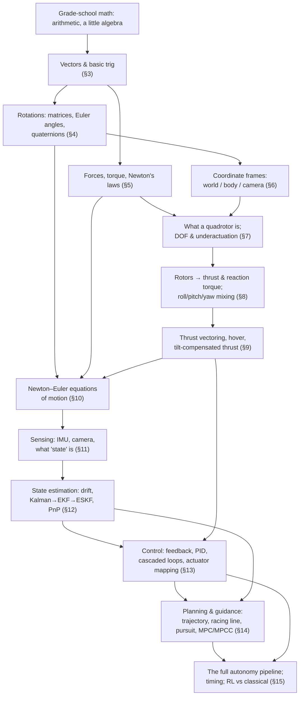
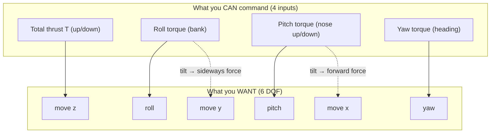
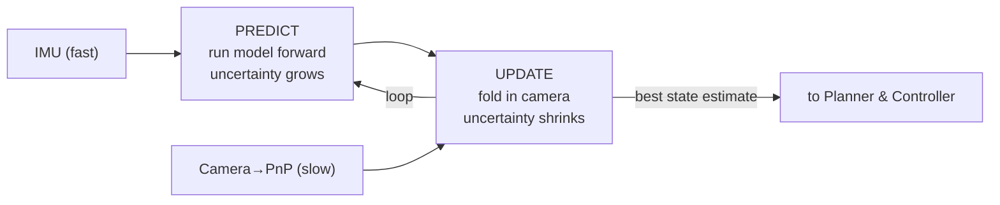
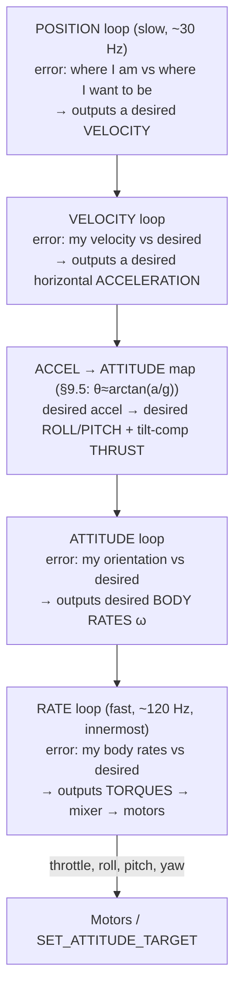
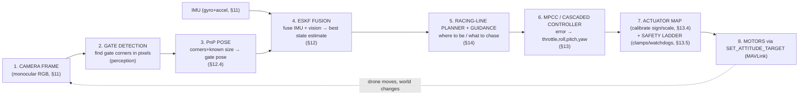

# Autonomous Drones — From Zero to Full Autonomy

*A ground-up mastery guide. Built around a real system: the **AI Grand Prix** autonomous FPV drone-racing stack (camera + IMU only, no GPS, no depth). Every term is defined the first time it appears. Every symbol is taken apart. Every algebra step is shown. Nothing is referenced that is not reproduced in full.*

---

## 0. How to read this guide

This is long **on purpose**. Reading it once will *not* make you a master — reading it once makes you *familiar*, and familiarity is a trap (you recognize the words and mistake that for being able to produce them). Real mastery is built by **doing**: recalling from memory, re-deriving, and solving faded practice problems. So:

- Every section opens with **why you're learning this** — the problem it solves — so nothing is abstract trivia.
- **Intuition first, then the math.** You get a plain-language picture before any symbols.
- **Active-recall checkpoints** appear throughout. When you hit one, *look away and answer out loud or on paper before revealing the answer*. This effort is the learning.
- At the end there is **faded practice**, an **interleaved problem set**, a **mastery checklist**, a **spaced-review schedule with flashcards**, and a **glossary**.

A note on notation that will recur: I write multiplication as `·` (a dot) or by putting symbols next to each other. I write `x²` for "x squared" (x times itself) and `√x` for "square root of x." Greek letters get named the first time (for example, "θ, lowercase theta"). That is the only pre-knowledge assumed beyond grade-school arithmetic and reading.

---

## 1. What you'll be able to do by the end

By the end of this guide you will be able to:

- Explain what a quadrotor is, why it has exactly the flying behavior it has, and why it is **underactuated** (4 controls, 6 ways to move).
- Explain and compute how spinning propellers make **thrust** (a push) and **reaction torque** (a twist), and how the four motors together make the drone climb, roll, pitch, and yaw.
- Explain **thrust vectoring** on a quad — why the *only* way a quad moves sideways is by *tilting* — and compute **tilt-compensated thrust**.
- Read and write the three **coordinate frames** (world, body, camera) and convert between them using **rotation matrices** and **quaternions**.
- Write the **Newton–Euler equations of motion** of a quadrotor and say what every term means.
- Explain **state estimation**: why integrating an **IMU** drifts, how a **Kalman filter** fuses noisy sensors, and what an **Error-State Kalman Filter (ESKF)** adds. Explain how a camera looking at a gate gives a pose (**PnP**).
- Design a **PID** controller from scratch and stack them into a **cascaded** (inner/outer-loop) controller: rate → attitude → velocity → position.
- Explain **planning and guidance**: reference trajectories, a racing line, pursuit guidance, and what **MPC / MPCC** does.
- Tie it all together into the full **autonomy pipeline** — perception → estimation → planning → control — and explain how a machine becomes "fully autonomous."

**The concrete system we'll keep pointing at.** The AI Grand Prix is a drone-racing competition where every team flies *identical hardware*, so the software is the only difference. Our drone must fly itself through a course of **gates** (square frames it flies through) using only:

- one forward-facing **monocular** RGB camera (monocular = a *single* lens, so no built-in depth), pitched about 20° downward, and
- a 6-axis **IMU** (a motion sensor — defined fully later),

with **no GPS**, **no depth sensor**, **no stereo**, **no LiDAR**. The software pipeline is:

> Camera Frame → Gate Detection → PnP Pose → ESKF Fusion → Racing-Line Planner → MPCC / Controller → Throttle, Roll, Pitch, Yaw commands.

Every one of those boxes is a section of this guide. By the end, that line will read like a sentence you fully understand.

---

## 2. The prerequisite map

Here is the whole dependency tree — what depends on what. Read it top-to-bottom: the things at the top are needed to understand the things below them. This *is* the table of contents.



**How to use the map:** never let yourself read a section whose parents you haven't understood. If §13 (control) feels shaky, the fix is almost always upstream — go back to §5 (forces/torque) or §9 (thrust vectoring). The map tells you *where* to go back to.

---

# FOUNDATIONS

---

## 3. Vectors and a little trigonometry

**Why you're learning this.** A drone lives in 3-D space. To say *where* it is, *which way* it's moving, *which way* it's pointed, and *which way* a force pushes it, we need a compact way to write "an amount **in a direction**." That object is a **vector**. Trigonometry is the tiny bit of geometry that lets us break a tilted direction into "how much sideways" and "how much up" — which is *exactly* what a tilted drone does to its thrust. Almost every equation later is vectors and a sprinkle of trig.

### 3.1 Scalars vs vectors

A **scalar** is a plain number with a unit: `5 meters`, `−3.2 meters/second`, `0.30` (throttle fraction). It has size but no direction.

A **vector** is an arrow: it has a **magnitude** (how long/how much) *and* a **direction**. We write a vector as a stack of numbers, its **components**, one per axis:

$$\mathbf{v} = \begin{bmatrix} v_x \\ v_y \\ v_z \end{bmatrix}$$

Let me decompose that:

- **The whole object** `v` (bold, or sometimes written $\vec{v}$ with a little arrow) is "the vector v."
- **`v_x`** is read "v-sub-x": the **x-component**, i.e. *how much of the vector points along the x-axis*. The subscript `x` is an **address** naming *which axis*, not a multiplication.
- Likewise `v_y` and `v_z` are the amounts along the y- and z-axes.
- **Why a stack?** Writing three numbers in a column is shorthand for "this much east, this much north, this much up" all in one symbol. It lets one letter `v` stand for three numbers at once.
- **Units:** a velocity vector has each component in meters/second (m/s); a position vector in meters (m); a force vector in newtons (N, defined in §5).

Example: a drone moving at 2 m/s East and 1 m/s Up (nothing North) has velocity `v = [2, 0, 1]` m/s (using x=East, y=North, z=Up).

### 3.2 Magnitude (length) of a vector

The **magnitude** `|v|` (read "the magnitude of v" — the vertical bars mean "size of") is how long the arrow is. In 2-D, it's the Pythagorean theorem; in 3-D it's the same idea with one more term:

$$|\mathbf{v}| = \sqrt{v_x^2 + v_y^2 + v_z^2}$$

Term by term: square each component (that makes each positive and weights bigger amounts more), add them, take the square root to get back to the original units.

Worked example, one step per line, with `v = [2, 0, 1]` m/s:

```
|v| = √(v_x² + v_y² + v_z²)             (the formula)
    = √(2² + 0² + 1²)                   (plug in the components)
    = √(4 + 0 + 1)                      (square each: 2²=4, 0²=0, 1²=1)
    = √5                                (add: 4+0+1 = 5)
    ≈ 2.236 m/s                         (√5 ≈ 2.236)
```

So the drone's *speed* (magnitude of velocity) is about 2.24 m/s. **Speed is a scalar; velocity is a vector.** That distinction matters later: a controller may be happy with your *speed* but need to fix your *direction*.

### 3.3 Adding vectors, and scaling them

**Adding** two vectors = add matching components. If wind pushes you `[1, 0, 0]` and your motor pushes you `[2, 0, 1]`, the total is:

```
[2,0,1] + [1,0,0] = [2+1, 0+0, 1+0] = [3, 0, 1]
```

**Scaling** (multiplying a vector by a scalar `s`) stretches it and multiplies each component by `s`: `2·[3,0,1] = [6,0,2]`. If `s` is negative it also flips the direction. This is how "twice the thrust" or "opposite direction" is written.

### 3.4 Unit vectors and direction

A **unit vector** is a vector with magnitude exactly 1 — it carries *pure direction*, no size. We put a little hat on it: $\hat{\mathbf{u}}$ ("u-hat"). To make any vector into a unit vector pointing the same way, divide it by its own magnitude: $\hat{\mathbf{u}} = \mathbf{v}/|\mathbf{v}|$. This matters because we'll often want "which way is thrust pointing?" separately from "how strong is it?"

### 3.5 The three trig ratios you need

Picture a right triangle (one 90° corner). Pick one of the other angles and call it **θ (lowercase theta)** — θ is just the traditional letter for "an angle." Label the three sides *relative to θ*:

- **hypotenuse** — the longest side, opposite the 90° corner.
- **opposite** — the side across from θ.
- **adjacent** — the side next to θ (not the hypotenuse).

The three ratios (memorize as **SOH-CAH-TOA**):

$$\sin\theta = \frac{\text{opposite}}{\text{hypotenuse}}, \qquad \cos\theta = \frac{\text{adjacent}}{\text{hypotenuse}}, \qquad \tan\theta = \frac{\text{opposite}}{\text{adjacent}} = \frac{\sin\theta}{\cos\theta}$$

- **sin θ** ("sine of theta") and **cos θ** ("cosine of theta") are just numbers between −1 and 1 that depend on the angle.
- **tan θ** ("tangent") is their ratio.

**Why this is the crux of drone flight.** When a drone tilts by angle θ, its thrust arrow (length `T`, the hypotenuse) splits into:

- an **upward** part `T·cos θ` (adjacent, holds it against gravity), and
- a **sideways** part `T·sin θ` (opposite, pushes it across).

That single triangle is why a drone must tilt to move, and why it must add *extra* thrust when tilted to keep from sinking. We'll use exactly this in §9.

Two facts to bank: at θ = 0 (level), `cos 0 = 1` and `sin 0 = 0` (all thrust is up, none sideways). At a small tilt, `cos θ` is still near 1 but `sin θ` grows roughly like θ itself.

> **Active-recall checkpoint 3.**
> (a) A vector is `[3, 4, 0]`. What is its magnitude?
> (b) A drone tilts 30°. If its thrust magnitude is `T`, what are its upward and sideways parts? (Use `sin 30° = 0.5`, `cos 30° ≈ 0.866`.)
>
> <details><summary>Reveal</summary>
>
> (a) `√(3² + 4² + 0²) = √(9+16+0) = √25 = 5`.
> (b) Upward `= T·cos 30° ≈ 0.866·T`. Sideways `= T·sin 30° = 0.5·T`. Notice it lost about 13% of its lift (0.866 instead of 1.0) the moment it tilted — remember that number; it's why tilt-compensation exists.
> </details>

---

## 4. Rotations: matrices, Euler angles, quaternions

**Why you're learning this.** A drone is constantly *rotated* relative to the world: it banks, it pitches, its camera points down 20°. To use a camera measurement ("the gate is up-and-left in my image") we must express it in world terms ("the gate is over there and above me"), and that conversion *is* a rotation. Every coordinate-frame conversion, every attitude estimate, every "which way is up for me right now" is a rotation. There are three common ways to write a rotation — **rotation matrix**, **Euler angles**, **quaternion** — and each has a job. Our real project learned the hard way that the *choice of representation* can be the difference between stable flight and a tumble (naive Euler-angle PID tumbled; quaternion attitude targets flew).

### 4.1 What "a rotation" even is

A **rotation** is an operation that takes a direction and turns it to a new direction, *without stretching it*. "Rotate 90° about the vertical axis" turns "facing East" into "facing North." A rotation is not a place; it's a *turn*.

We need rotations because a vector's *components* depend on **which frame** you measure them in. The gate is in a fixed spot, but "the gate relative to me" changes as I bank and yaw. A rotation converts the numbers from one frame to another.

### 4.2 Angles in radians

First, a units note. Angles can be measured in **degrees** (a full circle = 360°) or **radians** (a full circle = 2π ≈ 6.283 radians, where **π, "pi," ≈ 3.14159**). Engineers and all the math/code use **radians** because the formulas come out clean. Conversion:

$$\text{radians} = \text{degrees} \times \frac{\pi}{180}, \qquad \text{degrees} = \text{radians} \times \frac{180}{\pi}$$

Example: 90° `= 90 · (π/180) = π/2 ≈ 1.571 rad`. A small 20° camera tilt `= 20·(π/180) ≈ 0.349 rad`. **Our project stores every angle internally in radians** (the CLAUDE.md rule "SI units internally"), converting to degrees only for human-readable logs.

### 4.3 The rotation matrix

A **matrix** is a grid of numbers. A **rotation matrix** `R` is a special 3×3 grid (3 rows, 3 columns) that, when it multiplies a vector, rotates that vector.

$$\mathbf{v}' = R\,\mathbf{v}$$

- `v` is the original vector (3 numbers), `v'` ("v-prime") is the rotated result (3 numbers).
- `R` is the 3×3 rotation. "Prime" just means "the new/rotated version."

**How a matrix multiplies a vector** (this is the one mechanical rule you need). Each component of the output is a **dot product**: multiply matching entries of a matrix *row* and the vector, then add. For a 2-D example rotating by angle θ:

$$R(\theta) = \begin{bmatrix} \cos\theta & -\sin\theta \\ \sin\theta & \cos\theta \end{bmatrix}, \qquad R\begin{bmatrix}x\\y\end{bmatrix} = \begin{bmatrix} \cos\theta\cdot x - \sin\theta\cdot y \\ \sin\theta\cdot x + \cos\theta\cdot y\end{bmatrix}$$

Worked example — rotate the point `[1, 0]` (pointing "East") by θ = 90° (so `cos 90° = 0`, `sin 90° = 1`), one step per line:

```
top    = cosθ·x − sinθ·y = 0·1 − 1·0 = 0 − 0 = 0
bottom = sinθ·x + cosθ·y = 1·1 + 0·0 = 1 + 0 = 1
result = [0, 1]  → now pointing "North". ✓ (a 90° left turn)
```

That is *all* a rotation matrix does: it re-mixes the components with sines and cosines so the arrow ends up turned. In 3-D, `R` is 3×3 and does the same for x, y, z.

**Why the matrix form matters:** it's the workhorse for converting whole batches of points between frames (e.g. converting a detected gate's corners from camera coordinates to body coordinates — literally the `CAM_TO_BODY` matrix in our code). Two facts to bank: to *undo* a rotation you use its **transpose** (flip rows and columns), written `Rᵀ`, because for rotation matrices the inverse equals the transpose; and rotating then rotating again = multiplying the matrices.

### 4.4 Euler angles: roll, pitch, yaw

**Euler angles** (named after the mathematician Euler, pronounced "OY-ler") describe any orientation as **three successive turns** about three axes. For aircraft they have famous names:

- **Roll (φ, lowercase phi)** — tilt left/right, like banking into a turn (rotation about the forward axis).
- **Pitch (θ, theta)** — nose up/down (rotation about the sideways axis).
- **Yaw (ψ, lowercase psi)** — turn left/right / heading / "which compass direction the nose points" (rotation about the vertical axis).

These three are wonderfully intuitive — a pilot thinks in roll/pitch/yaw — and we *command* the drone in these terms (SET_ATTITUDE_TARGET). That's their job: **human- and command-friendly**.

**Their fatal flaw: gimbal lock and wrap-around.** When pitch reaches 90° (nose straight up), roll and yaw axes line up and one degree of freedom silently vanishes — this is **gimbal lock**, and near it the math blows up (you divide by numbers near zero). Also, yaw "wraps" from +180° to −180°, causing discontinuities. A controller doing arithmetic on Euler angles near these spots can command nonsense and **tumble the drone**. This is not hypothetical: in our project, "naive PID on Euler angles" tumbled the drone, while switching to **quaternion** attitude targets gave 60+ seconds of stable flight. Euler angles are great for *talking*; bad for *computing through big tilts*.

### 4.5 Quaternions: the rotation representation that doesn't break

A **quaternion** is a set of **four numbers** that together encode a rotation without gimbal lock and without wrap-around discontinuities. Four numbers to describe a 3-D rotation sounds like one too many, and it is — the redundancy is exactly what buys the smooth, singularity-free behavior.

Intuition: *any* 3-D orientation can be reached by a **single rotation of some angle α about some axis** (a unit vector `n̂ = [n_x, n_y, n_z]`). A quaternion just packages that "angle + axis" cleverly:

$$\mathbf{q} = \begin{bmatrix} q_x \\ q_y \\ q_z \\ q_w \end{bmatrix} = \begin{bmatrix} n_x \sin(\alpha/2) \\ n_y \sin(\alpha/2) \\ n_z \sin(\alpha/2) \\ \cos(\alpha/2) \end{bmatrix}$$

Decomposing the symbol:

- **The whole object `q`** is one rotation, stored as four numbers.
- **`q_x, q_y, q_z`** are the **vector part** — they encode the *axis* you turn about (scaled by `sin(α/2)`).
- **`q_w`** is the **scalar part** — it encodes *how much* you turn (`cos(α/2)`).
- **α (lowercase alpha)** is the total rotation angle; **n̂** is the axis unit vector.
- **Why half the angle (α/2)?** It's a property of the quaternion math that makes rotations *compose* correctly (do-one-then-another = multiply the quaternions). You don't need to derive it now; just know `q_w = cos(α/2)`, so `q_w = 1` means α = 0 = "no rotation."
- **Units:** quaternion components are pure numbers (no units); a valid rotation quaternion always has magnitude 1: `q_x² + q_y² + q_z² + q_w² = 1` ("unit quaternion"). Software **re-normalizes** it every step to keep it exactly length-1.

**Scalar-last vs scalar-first — a real footgun.** There are two conventions for the *order* of the four numbers:

| Convention | Order | Who uses it (in our world) |
|---|---|---|
| **Scalar-last** | `[x, y, z, w]` | Our internal code; ROS; many robotics stacks |
| **Scalar-first** | `[w, x, y, z]` | **SciPy** (`scipy.spatial.transform`), Eigen, some MAVLink fields |

They hold the *same* rotation but in a *different slot order*. Hand `[x,y,z,w]` to a library expecting `[w,x,y,z]` and it silently interprets your "w" as an axis component — the drone rotates wrongly and you chase a "physics bug" that is really a **plumbing bug**. Our CLAUDE.md pins this down explicitly: *"quaternions scalar-last `[x, y, z, w]` unless interfacing with scipy (scalar-first)."* That single sentence exists because this bites everyone once.

> **Active-recall checkpoint 4.**
> (a) Name the three Euler angles and the plain-English motion of each.
> (b) Why can a quaternion-based controller stay stable through a maneuver where an Euler-angle one tumbles?
> (c) You have a quaternion `[0.1, 0.0, 0.0, 0.995]` in scalar-last order. Which number is the scalar part, and is this close to "no rotation"?
>
> <details><summary>Reveal</summary>
>
> (a) Roll = bank left/right; Pitch = nose up/down; Yaw = turn/heading.
> (b) Quaternions have **no gimbal lock and no wrap-around discontinuity**, so the math stays smooth and well-defined at big tilts where Euler angles hit a singularity (divide-by-near-zero) or a ±180° jump.
> (c) Scalar-last means the *last* number, `0.995`, is `q_w`. Since `q_w = cos(α/2) ≈ 0.995` is very close to 1, the angle is small — yes, it's nearly "no rotation" (a tiny roll about x).
> </details>

---

## 5. Forces, torque, and Newton's laws

**Why you're learning this.** A drone is a physical body pushed around by pushes (**forces**) and twisted by twists (**torques**). *All* of flight — climbing, tilting, spinning, drifting — is forces and torques acting on a mass. If you own this section, the equations of motion in §10 are just bookkeeping. If you don't, they'll look like hieroglyphs.

### 5.1 Mass, force, and Newton's second law

**Mass (`m`)** is how much "stuff" (inertia) a body has — how hard it is to speed up or slow down. Unit: kilograms (kg). Our racing drone is roughly `m ≈ 0.5–1 kg`.

A **force** is a push or a pull — a vector (it has size and direction). Unit: the **newton (N)**, defined so that 1 N accelerates 1 kg by 1 m/s² (meter per second, per second — see below).

**Acceleration (`a`)** is how fast velocity changes, a vector, unit m/s² ("meters per second squared"). If your velocity goes from 0 to 2 m/s in 1 second, your acceleration was 2 m/s².

**Newton's second law** — the single most important equation in all of this:

$$\mathbf{F} = m\,\mathbf{a} \qquad\Longleftrightarrow\qquad \mathbf{a} = \frac{\mathbf{F}}{m}$$

- **`F`** is the **total** (net) force vector — add up *every* push acting on the body.
- **`m`** is the mass (a scalar).
- **`a`** is the resulting acceleration vector.
- **In words:** net push ÷ mass = how fast you speed up, in the direction of the push. Heavier body → same push gives less acceleration. This is why we write `a = F/m`: given the forces, it *predicts the motion*.

**Newton's first law** ("things keep doing what they're doing unless pushed") and **third law** ("every push has an equal and opposite push back") also matter. The third law is *literally how a propeller works* and how a quad yaws — we'll see that in §8.

### 5.2 The two forces on a hovering drone

At any instant, the dominant forces on our drone are:

1. **Gravity**, `F_grav = m·g`, always straight **down**, where **`g` ≈ 9.81 m/s²** is the acceleration gravity gives any free-falling object near Earth's surface. For `m = 0.7 kg`: `F_grav = 0.7 · 9.81 = 6.867 N` downward.
2. **Thrust**, `T`, the total push from the four spinning propellers, pointing along the drone's *own up-axis* (which tilts when the drone tilts — the key to everything in §9).

(There's also **drag**, air resistance opposing motion, and gyroscopic/aero effects — small at low speed, so we set them aside until they matter.)

To **hover** (stay put), thrust must exactly cancel gravity: `T = m·g`, pointing straight up. That's the **hover condition**, and it's why a *hover throttle* exists (our measured value ≈ 0.30, i.e. 30% throttle just holds altitude).

### 5.3 Torque: the rotational push

A **torque (τ, lowercase tau)** is a *twisting* effort — what a wrench applies to a bolt, or what makes the drone start to roll/pitch/yaw. A torque is produced by a force applied at a distance from a pivot:

$$\tau = r \times F \quad(\text{magnitude: } \tau = r \cdot F \cdot \sin\theta)$$

- **`r`** is the **lever arm** — the distance from the pivot (center of mass) to where the force acts. Unit: meters.
- **`F`** is the force. Unit: newtons.
- **θ** is the angle between them; for a force applied perpendicular (the useful case) `sin θ = 1`, so `τ = r·F`.
- **Unit of torque:** newton-meters (N·m).
- **The `×` (cross product)** signals torque is a *vector* whose direction is the **axis** you'd twist about — but for our purposes the key content is the magnitude `r·F`: *more force, or a longer arm, twists harder.*

Example: a motor makes 3 N of thrust at the end of a 0.15 m arm. Its torque about the drone's center is `τ = r·F = 0.15 · 3 = 0.45 N·m`. Put a *stronger* motor on one side than the other and the imbalance twists the drone — **that is how a quad rolls and pitches** (§8).

### 5.4 Rotational inertia and the angular version of Newton's law

Just as mass resists linear acceleration, **moment of inertia (`I`)** resists *angular* acceleration — it's "rotational mass," how hard the body is to spin up. A long thin drone is easy to spin about its long axis, hard about others; `I` captures that. Newton's second law has a rotational twin:

$$\boldsymbol{\tau} = I\,\boldsymbol{\alpha} \qquad\Longleftrightarrow\qquad \boldsymbol{\alpha} = \frac{\boldsymbol{\tau}}{I}$$

where **`α` here is angular acceleration** (how fast the spin-rate changes, in rad/s²) — same Greek letter as before, different context (unavoidable convention; the meaning is clear from setting). Net torque ÷ inertia = angular acceleration. This governs how fast the drone can *start* rolling when you unbalance the motors.

### 5.5 Angular velocity

**Angular velocity (ω, lowercase omega)** is *how fast* the body is spinning right now, and about which axis — a vector, unit rad/s. Its three components are the **body rates**:

$$\boldsymbol{\omega} = \begin{bmatrix} p \\ q \\ r \end{bmatrix} = \begin{bmatrix} \text{roll rate} \\ \text{pitch rate} \\ \text{yaw rate}\end{bmatrix}$$

- `p` = how fast it's *rolling* (rad/s), `q` = *pitching*, `r` = *yawing*.
- **This is exactly what the gyroscope in the IMU measures** (§11), and exactly what the *inner loop* of the controller commands (§13). Our whole rate-calibration saga (below) is about `ω`.

> **Active-recall checkpoint 5.**
> (a) State Newton's second law in words and symbols, and rearrange it to solve for acceleration.
> (b) A `0.7 kg` drone hovers. What thrust (N) and direction does it need? (`g = 9.81`.)
> (c) What produces a *twist* rather than a push, and what two things make a bigger twist?
>
> <details><summary>Reveal</summary>
>
> (a) Net force equals mass times acceleration, `F = m·a`; solving, `a = F/m` — acceleration is net force divided by mass.
> (b) `T = m·g = 0.7 · 9.81 = 6.867 N`, pointing straight **up** to cancel gravity.
> (c) A **torque**, `τ = r·F`. A bigger force `F` or a longer lever arm `r` both make a bigger twist.
> </details>

---

# BUILD-UP

---

## 6. Coordinate frames: world, body, camera

**Why you're learning this.** Every number in the system — a velocity, a gate position, a thrust direction — is only meaningful *relative to some frame of reference*. "The gate is 2 m to the left" — left of *whom*? The camera? The drone body? The world? Mixing frames is the single most common source of "my physics is right but the drone flies backward" bugs (our project fought exactly this class of bug for weeks). Nail down the three frames now and the rest stays sane.

### 6.1 What a frame is

A **coordinate frame** (or "frame of reference") is a chosen origin (a "you-are-here" point) plus three perpendicular axes (x, y, z) that we measure everything against. A vector's *components* are its shadows on those axes — so **the same physical arrow has different components in different frames**. Converting between frames is done with the rotations of §4.

### 6.2 The three frames we use

**1. World frame (W)** — fixed to the ground; it does not move. Positions and the racing line live here. Two common conventions:

- **NED (North-East-Down):** x = North, y = East, z = **Down**. Used by MAVLink (the drone messaging standard) and aviation.
- **Z-up (ENU-like):** z points **up**. More intuitive for humans.
- **⚠️ Our project's live headache:** the sim says "local Cartesian" without pinning the convention, and MAVLink's `SET_POSITION_TARGET_LOCAL_NED` is **NED (z-down)** while our internal math is **z-up** — so a **conversion layer** is required at the MAVLink boundary, and getting its sign wrong flips the drone's commanded direction. This is why "which way is z" is not pedantry.

**2. Body frame (B)** — glued to the drone, moves and tilts *with* it. Convention: **FRD (Front-Right-Down):** x = Front (nose), y = Right, z = Down (out the belly). Origin at the **center of mass**. The IMU reports in this frame; thrust points along body **−z** (up, out the top). When you command "roll," "pitch," "yaw," those are rotations of the body frame.

**3. Camera frame (C)** — glued to the camera lens. Convention (OpenCV standard): **x = Right, y = Down, z = Forward (out the lens)**. When gate detection says "the gate center is at pixel (320, 240)," that's a direction in the camera frame.

### 6.3 The chain that makes our drone fly

The whole point of having three frames is that data is *born* in one and *needed* in another. Follow one gate detection through the chain:


- A gate is *seen* in the **camera** frame (pixels).
- We rotate it into the **body** frame using a *fixed* rotation `CAM_TO_BODY` that encodes how the camera is bolted on — including that **~20° downward pitch** our project measured. (If you get that 20° wrong, every gate looks higher or lower than it is.)
- We rotate it into the **world** frame using the drone's current **attitude** (its orientation quaternion) — so guidance can reason about "where is the gate in the actual world."

Get any link's rotation wrong and the drone confidently flies at the wrong place. **Frames are the grammar; rotations are the verbs.**

### 6.4 Degrees of freedom (DOF)

A **degree of freedom (DOF)** is one independent way a body can move. A rigid body in 3-D space has exactly **6 DOF**:

- **3 translational:** move along x, y, z (forward/back, left/right, up/down).
- **3 rotational:** roll, pitch, yaw.

Six numbers fully describe where a drone is and how it's oriented. Hold onto "6" — the next section contrasts it with the number of things we can *directly control*, and that mismatch defines the entire challenge of quadrotor flight.

> **Active-recall checkpoint 6.**
> (a) A gate detection is born in which frame, and which frame must guidance ultimately reason in?
> (b) What does the `CAM_TO_BODY` rotation encode physically, and what specific mounting detail did our project have to bake into it?
> (c) How many DOF does a rigid drone have, and what are they?
>
> <details><summary>Reveal</summary>
>
> (a) Born in the **camera** frame (pixels); guidance needs it in the **world** frame (via the body frame in between).
> (b) It encodes how the camera is physically mounted on the body — orientation and the fact that our camera is pitched **~20° downward**.
> (c) **6 DOF**: 3 translations (x, y, z) + 3 rotations (roll, pitch, yaw).
> </details>

---

## 7. What a quadrotor is; underactuation

**Why you're learning this.** This section names the central, defining difficulty of quadrotor control — **underactuation** — the fact that you *cannot* directly push the drone sideways. Every later trick (thrust vectoring, cascaded control, tilt-then-translate guidance) exists to work *around* this one fact. Our project's biggest breakthrough was literally the user realizing "yaw doesn't steer — only tilting the thrust vector moves us." That realization *is* this section.

### 7.1 The machine

A **quadrotor** (or **quadcopter**, "quad") is a drone with **four rotors** (spinning propellers) arranged in a square, typically in an "X." Each rotor is driven by a motor whose speed we can set. Two rotors spin clockwise (CW), two counter-clockwise (CCW), arranged diagonally — this pairing is what lets it control yaw without spinning out of control (§8).

The **only four things software can directly command** are the four motor speeds — or, equivalently and more usefully, four *combinations* of them:

1. **Total thrust** `T` (all four together → up/down force),
2. **Roll torque** `τ_φ` (left pair vs right pair → bank),
3. **Pitch torque** `τ_θ` (front pair vs back pair → nose up/down),
4. **Yaw torque** `τ_ψ` (CW pair vs CCW pair → heading twist).

So we have **4 control inputs**. (In our stack we command these as **throttle, roll, pitch, yaw** via the MAVLink `SET_ATTITUDE_TARGET` message.)

### 7.2 Underactuation: 4 inputs, 6 DOF

Recall from §6.4 that the drone has **6 DOF**. But we just counted **4 inputs**. When a system has **fewer independent control inputs than degrees of freedom**, it is called **underactuated**.

$$\underbrace{4}_{\text{inputs}} \;<\; \underbrace{6}_{\text{DOF}} \qquad\Rightarrow\qquad \textbf{underactuated by }6-4=2.$$

**What this means physically:** there is **no motor that pushes the drone sideways.** All four propellers point the same way (out the top). You can make more total up-force, and you can make torques to *rotate*, but you *cannot* directly command "move right" the way you command "spin left." The two "missing" actuators are exactly the two horizontal translations.

**So how does it ever move sideways?** It **tilts**. By pitching or rolling, the drone points its up-pointing thrust *partly sideways*, and the sideways component drags it across. You **rotate in order to translate**. This coupling — "to go there, first lean that way" — is the entire personality of a quad, and it's the subject of §9 (thrust vectoring).

**Why yaw does not steer your path.** This is the misconception that cost our project real time, so state it precisely: **yaw only changes which way the nose points; it does not, by itself, change which way you're *moving*.** If you're drifting right at 6 m/s and you yaw to face left, you keep drifting right — now flying sideways-facing. To change your *velocity*, you must **tilt** (roll/pitch) to point thrust against the drift. Yaw is for aiming (camera/heading); tilt is for steering. Burn that in.



The **solid arrows** are direct control. The **dashed arrows** — moving in x and y — are only reachable *indirectly*, by first creating a tilt. That indirection is underactuation, drawn.

> **Active-recall checkpoint 7.**
> (a) Give the numbers: how many inputs, how many DOF, and what's the degree of underactuation?
> (b) A quad is drifting to the right. You yaw 90° to face left. Are you still drifting right? What must you actually do to stop the drift?
>
> <details><summary>Reveal</summary>
>
> (a) 4 inputs, 6 DOF, underactuated by **2**.
> (b) **Yes, still drifting right** — yaw only re-aims the nose. To stop the drift you must **roll/pitch (tilt) the thrust vector** so thrust has a component pointing *left*, decelerating the rightward velocity.
> </details>

---

## 8. Rotors → thrust and reaction torque; motor mixing

**Why you're learning this.** This is the drone-specific physics the user asked for by name ("thrust vectors and other stuff like that"). Here we open the black box of *how spinning plastic makes a machine climb and spin*, and how four motors are **mixed** to produce the four controls of §7. Once you see the mixing, the phrase "throttle, roll, pitch, yaw command" becomes concrete motor arithmetic.

### 8.1 How a propeller makes thrust

A propeller is a set of tilted wings. Spin it and it flings air **downward**; by Newton's **third law** (every action has an equal, opposite reaction), the air pushes the propeller **upward** by the same amount. That upward push is **thrust**. More rotor speed → more air flung → more thrust. A good working model:

$$T_i = k_T \,\omega_i^2$$

- **`T_i`** ("T-sub-i") is the thrust from rotor number `i` (i = 1,2,3,4). Unit: newtons.
- **`ω_i`** ("omega-sub-i") is that rotor's spin rate (rad/s). *Note:* here ω is a **rotor** spin speed — different from the body angular velocity ω of §5.5; the letter is reused, the meaning is set by context (rotor `i`).
- **`k_T`** ("k-sub-T") is the **thrust coefficient** — a constant capturing the propeller's size and shape (bigger/steeper prop → bigger `k_T`). Unit chosen so the result is newtons.
- **Why `ω²` (speed *squared*)?** Two effects each scale with speed: faster spin moves *more* air per second, *and* throws each bit *faster*. Two factors of speed multiply → thrust grows with the **square** of speed. Double the rpm → roughly **four times** the thrust. This nonlinearity is why throttle feels touchy.

The **total thrust** is the sum of all four: `T = T_1 + T_2 + T_3 + T_4`.

### 8.2 Reaction torque → how a quad yaws

Here's the subtle one. To spin a propeller, the motor twists it — and by the third law again, the propeller twists the *drone body* the **opposite** way. This is **reaction torque** (also "drag torque"): a spinning CCW rotor tries to rotate the *body* CW.

$$Q_i = k_Q\,\omega_i^2$$

- **`Q_i`** is the reaction torque from rotor `i` (N·m). (We use `Q` so as not to clash with body-rate `q`.)
- **`k_Q`** is the **torque coefficient** — like `k_T` but for the twisting drag.
- Again **`ω²`**, for the same "more air, faster" reasoning.

**Why two rotors spin each way.** If all four spun the same direction, their reaction torques would add up and the whole drone would spin uncontrollably (like a single-rotor helicopter without a tail rotor). By spinning **two CW and two CCW**, in balanced flight the reaction torques **cancel** and the drone holds heading. To **yaw on purpose**, speed up the two rotors spinning one way and slow the other two: now the reaction torques *don't* cancel, and the leftover twist yaws the drone — *while total thrust stays the same* so altitude is unchanged. Yaw is "steal from one diagonal pair, give to the other."

### 8.3 The control-mixer: from 4 desired effects to 4 motor speeds

We *want* to command four things — total thrust `T`, and the three torques `τ_φ` (roll), `τ_θ` (pitch), `τ_ψ` (yaw). The **mixer** converts those into the four individual motor commands. For an "X" quad with rotors at front-right (1), back-right (2), back-left (3), front-left (4), a standard mix is:

```
motor1 (front-right) = T − roll − pitch − yaw
motor2 (back-right)  = T − roll + pitch + yaw
motor3 (back-left)   = T + roll + pitch − yaw
motor4 (front-left)  = T + roll − pitch + yaw
```

Read one column of logic at a time:

- **All four get `+T`:** raising `T` raises every motor equally → pure climb, no rotation. (This is the throttle channel and the hover condition.)
- **Roll:** left motors get `+`, right motors get `−` → right side pushes harder → the drone **banks left**. Pure couple, net vertical force unchanged.
- **Pitch:** front vs back imbalance → **nose tips up/down**.
- **Yaw:** the `±yaw` follows the CW/CCW pattern, so it nudges the *reaction-torque* balance (§8.2) — **not** by pushing, but by un-cancelling drag torques. That's why yaw authority is weaker and slower than roll/pitch: you're fighting with aerodynamic drag, not lift.

**This mixer is why the four "channels" are throttle/roll/pitch/yaw.** In our stack, the flight controller (or sim) does the final mixing; *we* send the higher-level `SET_ATTITUDE_TARGET` (desired orientation + thrust) or body-rate commands, and something downstream turns those into motor speeds via a mix like this.

> **Active-recall checkpoint 8.**
> (a) Why does thrust scale with the *square* of rotor speed, not just the speed?
> (b) If all four rotors spun the same direction, what would go wrong, and how does the CW/CCW split fix it?
> (c) In the mixer, adding the same amount to all four motors does what? Adding to the left pair and subtracting from the right does what?
>
> <details><summary>Reveal</summary>
>
> (a) Faster spin moves *more* air per second **and** throws it *faster* — two factors of speed multiply, so thrust ∝ ω².
> (b) All-same-direction → reaction torques add up → the body spins uncontrollably (no yaw authority). Two CW + two CCW makes the reaction torques **cancel** in balanced flight; deliberately unbalancing them gives controlled yaw at constant thrust.
> (c) All four up equally → pure **climb** (no rotation). Left `+`, right `−` → a **roll** (bank), with total vertical force unchanged.
> </details>

---

## 9. Thrust vectoring, hover, and tilt-compensated thrust

**Why you're learning this.** This is the beating heart of the guide and the user's headline request. "**Thrust vector**" for a quad means something specific: because all rotors point out the top, the thrust is a single arrow **fixed to the body**, and the *only* way to aim it is to **tilt the whole drone**. Steering = aiming that arrow. And because tilting the arrow steals lift from "up," you must add thrust to keep altitude — **tilt-compensated thrust**, a fix our project needed to stop the drone sinking every time it banked.

### 9.1 The thrust vector and what "thrust vectoring" means here

The **thrust vector** is the total-thrust arrow: magnitude `T` (from §8.1), direction = the drone's body-up axis (body **−z**). On some vehicles (rockets, some jets) you can swivel the nozzle to aim thrust — literal "thrust vectoring." **A quad cannot swivel anything.** Its thrust vectoring is *implicit*: you re-aim the whole airframe with roll/pitch, and the thrust arrow points wherever the body now points. So for us:

> **Thrust vectoring (quad sense) = tilting the body so the fixed thrust arrow gains a horizontal component that accelerates you sideways.**

This is the mechanism behind the dashed arrows in §7's diagram. It is *the* answer to "how does an underactuated quad move in the plane."

### 9.2 The tilt triangle (bringing back §3.5)

Tilt the drone by angle **θ** from vertical. Its thrust `T` (the hypotenuse of a right triangle) splits into:

$$T_{\text{up}} = T\cos\theta \qquad(\text{vertical, fights gravity})$$
$$T_{\text{horiz}} = T\sin\theta \qquad(\text{sideways, accelerates you})$$

```
        thrust T
          ↑ \
   T·cosθ |  \  T   ← the actual thrust arrow, tilted by θ
   (up)   |   \
          |  θ \
          +-----→ T·sinθ   (sideways push)
```

- `T cos θ` (adjacent) is what's left holding you up. At θ = 0 it's the full `T`; as you tilt it **shrinks**.
- `T sin θ` (opposite) is the new sideways push that moves you. At θ = 0 it's zero; it **grows** as you tilt.

This one triangle contains the whole trade-off: **tilt more → more sideways push, but less lift.** Ignore the lost lift and you **sink while you turn** — precisely the "floor sink" bug our project hit.

### 9.3 Hover condition (the anchor point)

To **hover**, thrust up must equal weight down, and there must be zero tilt (θ = 0 so no sideways push):

$$T_{\text{hover}} = m\,g$$

For `m = 0.7 kg`, `g = 9.81`: `T_hover = 6.867 N`. Expressed as a **throttle fraction** (0 = off, 1 = full), this is the **hover throttle** — our project *measured* it at **≈ 0.30** (30% throttle just holds altitude). Every altitude command is "hover throttle, plus a bit to climb, minus a bit to descend."

### 9.4 Tilt-compensated thrust (the fix)

Suppose you're tilted by θ to steer, but you still want to hold altitude — you need the *vertical* part of thrust to still equal weight:

$$\underbrace{T\cos\theta}_{\text{vertical part}} = m\,g \qquad\Rightarrow\qquad \boxed{\,T = \dfrac{m\,g}{\cos\theta}\,}$$

Deriving it, one step per line:

```
Want:   T·cosθ = m·g            (vertical thrust must still cancel weight)
Divide both sides by cosθ:
        T = (m·g) / cosθ         (solve for the thrust magnitude you must command)
```

Since `cos θ ≤ 1`, dividing by it makes `T` **bigger** than the hover thrust — you must **push harder while tilted**. This is **tilt-compensated thrust**. In throttle terms:

$$\text{throttle} = \frac{\text{hover\_throttle}}{\cos\theta} = \frac{0.30}{\cos\theta}$$

**Worked example** — hold altitude while banked 20° (`θ = 20° ≈ 0.349 rad`, `cos 20° ≈ 0.940`):

```
throttle = 0.30 / cos(20°)
         = 0.30 / 0.940            (cos 20° ≈ 0.940)
         = 0.319                   (do the division)
```

So a 20° bank needs about **0.319** throttle instead of 0.30 — about **6% more** — just to *not sink*. At 45° (`cos 45° ≈ 0.707`) it's `0.30/0.707 ≈ 0.424` — a **41% increase**. This is exactly why our controller applies "tilt-compensated thrust so the drone holds altitude while banking," and why *forgetting* it makes the drone descend every time it turns.

### 9.5 From "how hard to push" to "how hard to tilt"

We can also run the tilt triangle *backward*: if guidance wants a horizontal acceleration `a_horiz`, how much tilt θ does that require? The horizontal push is `T sin θ` and (at hover-ish thrust) `T ≈ mg`, and horizontal acceleration is force/mass `= T sin θ / m ≈ g·sin θ`. For small angles `sin θ ≈ tan θ ≈ θ`, giving the workhorse relation used to turn a *desired acceleration* into a *desired attitude*:

$$a_{\text{horiz}} \approx g\,\tan\theta \qquad\Rightarrow\qquad \theta \approx \arctan\!\left(\frac{a_{\text{horiz}}}{g}\right)$$

- **`arctan`** ("arc-tangent," the inverse of tan) takes a ratio and gives back the angle.
- **In words:** to accelerate sideways at `a_horiz`, tilt by about `arctan(a_horiz/g)`.

Example: want `a_horiz = 3 m/s²` sideways → `θ ≈ arctan(3/9.81) = arctan(0.306) ≈ 0.297 rad ≈ 17°`. This exact formula (`a = g·tanθ`) is what our project's "metric acceleration guidance" uses to convert a desired horizontal acceleration (toward the gate) into roll/pitch setpoints. It's the mathematical bridge between **planning** ("go there") and **control** ("tilt this much") — remember it for §13–§14.

> **Active-recall checkpoint 9.**
> (a) In one sentence, what does "thrust vectoring" mean for a quadrotor specifically?
> (b) Derive tilt-compensated thrust `T = mg/cosθ` from "vertical thrust must equal weight."
> (c) You bank 30° (`cos 30° ≈ 0.866`) and hover throttle is 0.30. What throttle holds altitude?
> (d) Guidance wants 2 m/s² sideways. Roughly what tilt angle? (`g = 9.81`.)
>
> <details><summary>Reveal</summary>
>
> (a) Because all rotors point out the top, the thrust arrow is fixed to the body; "thrust vectoring" means **tilting the whole drone** so that fixed arrow points partly sideways and accelerates you.
> (b) Vertical thrust part is `T cos θ`; set it equal to weight `mg`: `T cos θ = mg`; divide both sides by `cos θ`: `T = mg / cos θ`.
> (c) `0.30 / 0.866 ≈ 0.346` throttle.
> (d) `θ ≈ arctan(2/9.81) = arctan(0.204) ≈ 0.201 rad ≈ 11.5°`.
> </details>

---

## 10. Newton–Euler equations of motion of a quadrotor

**Why you're learning this.** Everything above becomes one compact **model** — a set of equations that *predicts* how the drone moves given its inputs. This model is what the **estimator** runs forward to guess your state between measurements, and what the **planner/controller** reasons against. You don't need to *solve* these by hand; you need to *read* them and know what each term is, because they're the skeleton of the whole stack.

### 10.1 The state: everything you must track

The drone's **state** is the smallest set of numbers that fully says "where it is and how it's moving." For a rigid quad:

| Symbol | Name | What it is | Units |
|---|---|---|---|
| `p` = [x, y, z] | position | where it is in the **world** frame | m |
| `v` = [vₓ, v_y, v_z] | velocity | how fast it's translating (world) | m/s |
| `q` = [qₓ,q_y,q_z,q_w] | attitude | its orientation (quaternion, §4.5) | — |
| `ω` = [p, q, r] | angular velocity | how fast it's rotating (body, §5.5) | rad/s |

That's **13 numbers** (3+3+4+3). (The attitude uses 4 numbers for the 3 rotational DOF — the quaternion's redundancy again.) Estimation (§12) is the art of *guessing these 13 numbers* from noisy sensors; control (§13) is the art of *driving them* to desired values.

### 10.2 Translational equation (how position/velocity evolve)

This is just Newton's second law (§5.1) with our two forces (§5.2), written in the world frame:

$$m\,\dot{\mathbf{v}} = \underbrace{R(\mathbf{q})\begin{bmatrix}0\\0\\-T\end{bmatrix}}_{\text{thrust, rotated to world}} \;+\; \underbrace{\begin{bmatrix}0\\0\\ +m g\end{bmatrix}}_{\text{gravity}}$$

Decoding every piece:

- **`v̇`** ("v-dot") — the dot on top means **rate of change** (the derivative). `v̇` is how fast velocity is changing = **acceleration**. So the left side is `m·a` — mass times acceleration.
- **`m`** — mass (§5.1).
- **`R(q)`** — the **rotation matrix built from the attitude quaternion `q`** (§4.3–4.5). Thrust is naturally "up in the *body*"; multiplying by `R(q)` expresses it in the **world** frame. *This is the term that makes tilting move you*: when `q` says "tilted," `R(q)` swings the thrust vector sideways — thrust vectoring, in one symbol.
- **`[0, 0, −T]`** — the thrust in **body** coordinates: magnitude `T`, pointing along body up (which is `−z` in the Down-positive FRD convention). This is the `T` we mixed in §8.
- **`[0, 0, +mg]`** — gravity in world coordinates, pointing **down** (`+z` = down here), size `mg` (§5.2).
- **In words:** *mass × acceleration = (thrust, aimed by the current attitude) + gravity.* Divide by `m` and you have `a = R(q)·(thrust/m) + gravity/m` — literally "which way am I pushed, and how does that accelerate me." Compare to the plain `a = F/m` from §5: this is the same law, just with the forces named and the thrust rotated into the world.

### 10.3 Rotational equation (how attitude/angular velocity evolve)

Two coupled statements. First, **how orientation changes with spin** (kinematics):

$$\dot{\mathbf{q}} = \tfrac{1}{2}\,\mathbf{q}\otimes\begin{bmatrix}\boldsymbol{\omega}\\0\end{bmatrix}$$

- **`q̇`** — rate of change of the attitude quaternion.
- **`⊗`** — **quaternion multiplication** (a special way to multiply four-number quaternions that composes rotations). You don't need to hand-compute it; know that *this line says "the orientation changes according to the current spin rate ω."*
- **`½`** — that factor-of-two-halving again, matching the half-angle in §4.5.
- **In words:** feed in the body rates `ω`, and this tells you how the orientation quaternion drifts moment to moment.

Second, **how spin changes with torque** — the rotational Newton's law (§5.4), with one extra "gyroscopic" term:

$$I\,\dot{\boldsymbol{\omega}} = \boldsymbol{\tau} \;-\; \boldsymbol{\omega}\times(I\,\boldsymbol{\omega})$$

- **`I`** — moment of inertia (§5.4), here a small 3×3 grid (one number per axis on its diagonal for a symmetric quad).
- **`ω̇`** — angular acceleration (how fast the spin-rate changes).
- **`τ`** — the total torque vector = the roll/pitch/yaw torques from the mixer (§8.3).
- **`ω × (Iω)`** — the **gyroscopic coupling** term: a fast-spinning body resists changes to its spin axis, coupling the axes together. Small at gentle rates; it's why aggressive maneuvers get "twitchy." For gentle flight you can almost ignore it.
- **In words:** *torque, minus a gyroscopic correction, spins the body up.* This is what the **inner rate loop** (§13) controls.

### 10.4 Reading the model as a pipeline

Put §10.2 and §10.3 together and you can trace cause → effect:

```
motor speeds ──mix(§8)──► T, τ ──rot. eqns(§10.3)──► ω, q (attitude) ──┐
                                                                        │  R(q) rotates thrust
                                                                        ▼
                                          transl. eqn(§10.2) ──► a ──► v ──► p (position)
```

Inputs (motor speeds) make thrust and torques; torques change orientation; orientation aims the thrust; aimed thrust plus gravity accelerates the body; acceleration integrates to velocity, velocity to position. **That causal chain is the drone.** Control runs it *backward* ("I want this position → therefore this velocity → this attitude → these torques → these motor speeds"), which is exactly the cascaded controller of §13.

> **Active-recall checkpoint 10.**
> (a) The 13-number state is made of which four groups?
> (b) In the translation equation, what does the `R(q)` do to the thrust, and why is that the mathematical form of "thrust vectoring"?
> (c) What does a "dot" over a symbol (like `v̇`) mean?
>
> <details><summary>Reveal</summary>
>
> (a) Position `p` (3), velocity `v` (3), attitude quaternion `q` (4), angular velocity `ω` (3) = 13.
> (b) `R(q)` rotates the body-fixed thrust `[0,0,−T]` into the **world** frame; when the attitude is tilted, `R(q)` gives the thrust a horizontal component — that *is* thrust vectoring expressed as a matrix multiply.
> (c) Rate of change (the derivative) — how fast that quantity is changing per second. `v̇` is acceleration.
> </details>

---

# SENSING, ESTIMATION, CONTROL, PLANNING

---

## 11. Sensing and state: IMU, camera, and what "state" is

**Why you're learning this.** The equations of §10 predict motion, but the drone doesn't *know* its state — it must *measure* it. Our drone has only two senses: an **IMU** and a **camera**. Understanding exactly what each one truly measures (and doesn't) tells you why estimation (§12) is hard and necessary. Under the VQ2 rules, direct position/attitude telemetry was *removed* — only IMU + camera remain — so "figure out where I am from these two noisy senses" is the entire game.

### 11.1 The IMU: gyroscope + accelerometer

An **IMU (Inertial Measurement Unit)** is a small chip with two sensors, reporting at high rate (hundreds of Hz) in the **body** frame:

**Gyroscope ("gyro")** — measures **angular velocity ω** directly: how fast the body is rolling/pitching/yawing (rad/s). This is a good, direct measurement of the body rates `[p, q, r]` — the inner control loop leans on it heavily.

**Accelerometer ("accel")** — measures **specific force**: the sum of all pushes *except gravity*, per unit mass (m/s²). A crucial subtlety that trips everyone:

> An accelerometer at rest on a table reads **+9.81 m/s² upward**, not zero — because the table is *pushing up* on it. In free-fall it reads **zero**. So the accelerometer measures "thrust + contact forces," **not** acceleration through space, and **not** gravity directly. To get motion, you must *subtract off* the modeled gravity.

Why this matters: at **hover**, the accel reads gravity's reaction (≈9.81 up), which conveniently tells you which way is "down" → a **tilt reference** (if "down" isn't where you expect, you're tilted). But the *instant* the drone accelerates hard (like a violent sim launch), thrust and motion contaminate that reading and the tilt estimate goes bad. Our project saw exactly this: the IMU-integrated vertical velocity read a *climb* during launch while the camera showed the drone skimming the floor — so we demoted IMU vertical velocity to "diagnostic only" and trusted the camera for height.

### 11.2 Dead reckoning and why the IMU alone drifts

**Dead reckoning** = estimating where you are purely by adding up your motion over time. With an IMU you'd:

1. **integrate** gyro → orientation, and
2. **integrate** accel (minus gravity) once → velocity, and **again** → position.

**Integration** means "add up little pieces over time" (rate × small time, accumulated). The killer problem: **every sensor has a tiny bias/noise, and integration accumulates it forever.** A constant accel error `ε` (epsilon, a small error) becomes:

- a velocity error growing like `ε·t` (linearly with time), and
- a position error growing like `½·ε·t²` (with time *squared* — explosively).

$$\text{position drift} \approx \tfrac{1}{2}\,\varepsilon\,t^2$$

**Worked feel for it:** a tiny bias `ε = 0.1 m/s²` (1% of gravity) gives, after just `t = 10 s`:

```
position drift ≈ ½ · 0.1 · 10²
              = ½ · 0.1 · 100      (10² = 100)
              = 5 meters           (½ · 10)
```

**5 meters of error in 10 seconds from a 1% bias.** That's why **an IMU alone cannot navigate** — it's fantastic for *fast, short-term* motion (rates, sudden accelerations) but *rots* over seconds. This is the core motivation for sensor fusion (§12): pair the fast-but-drifting IMU with a slow-but-absolute reference — the camera.

### 11.3 The camera and monocular depth ambiguity

A **camera** measures **direction**, not distance. Each pixel is a ray: "there is something *this way*," but not *how far*. A **monocular** (single-lens) camera therefore has an inherent **scale/depth ambiguity** — a small close gate and a big far gate can make the *same* image. Our drone has exactly this limitation (no stereo, no depth sensor).

The escape hatch: if you **know the real-world size of the thing you're looking at** — and we do, because gate dimensions are given in the spec (CLAUDE.md: "MUST NOT hardcode gate dimensions — read from config") — then the *apparent size and shape* of the gate in the image pins down its distance and pose. Turning "a known-size shape's image" into "its 3-D position and orientation" is the **PnP** problem (§12.4). The camera is slow-ish and needs good lighting, but unlike the IMU it does **not drift** — it re-anchors you to the physical world every frame. That complementary pairing (fast-drifting IMU + slow-absolute camera) is *exactly* what a fusion filter is built to exploit.

> **Active-recall checkpoint 11.**
> (a) What does a gyro measure? What does an accelerometer *actually* measure (and what does it read sitting still)?
> (b) A 0.2 m/s² accel bias runs for 5 s. Estimate the position drift, and say why the IMU can't navigate alone.
> (c) Why can't a single camera directly measure how far away a gate is, and what fact rescues us?
>
> <details><summary>Reveal</summary>
>
> (a) Gyro → **angular velocity** (body rates). Accel → **specific force** (all forces except gravity, per mass); at rest it reads **≈ +9.81 m/s² up** (the table's push), not zero.
> (b) `½·0.2·5² = ½·0.2·25 = 2.5 m` of drift in 5 s. Integration squares small biases into large position errors, so IMU-only estimates rot within seconds.
> (c) A monocular camera measures **direction, not distance** — depth/scale is ambiguous. Knowing the **real gate dimensions** (from config) fixes the scale, letting PnP recover distance and pose.
> </details>

---

## 12. State estimation: Kalman → EKF → ESKF, and PnP

**Why you're learning this.** We have a fast-but-drifting IMU and a slow-but-absolute camera, both noisy. **State estimation** is the principled way to fuse them into one best guess of the 13-number state — better than either sensor alone. The **Kalman filter** and its variants (EKF, **ESKF**) are the standard tools, and our stack's "ESKF Fusion" box is exactly this. Even the *failure* here is instructive: when our ESKF's attitude estimate drifted, it *poisoned* the guidance and tumbled the drone — a live lesson that estimation errors propagate straight into control.

### 12.1 The idea of fusing a prediction with a measurement

Intuition first. You have two clues about a number (say your position):

- A **prediction** from the model (§10) run forward with the IMU — precise short-term, but *uncertain* and growing more so (it drifts).
- A **measurement** from the camera — noisy each frame, but *not drifting*.

A smart estimate **weights them by how much you trust each**: lean on the prediction right after a good measurement, lean on the camera when the prediction has had time to drift. The Kalman filter makes "how much you trust each" precise using each source's **uncertainty**.

We represent uncertainty with a **covariance**, `P` — loosely, "how wide is my cloud of doubt." Big `P` = "I'm unsure"; small `P` = "I'm confident." The filter tracks `P` right alongside the state estimate.

### 12.2 The Kalman filter loop (linear case)

A **Kalman filter** repeats two steps forever:

**1. Predict.** Push the state forward with the model, and *grow* the uncertainty (prediction adds doubt because the model is imperfect):

```
x̂⁻ = F·x̂           (predict next state from the model)
P⁻  = F·P·Fᵀ + Q    (predicted uncertainty grows by process noise Q)
```

- **`x̂`** ("x-hat") — the state *estimate* (hat = "our best guess," not the true value).
- **`x̂⁻`** — the *predicted* estimate before seeing the measurement (the minus means "prior/pre-update").
- **`F`** — the model that steps the state forward one tick (from §10).
- **`P`** — uncertainty (covariance). **`Q`** — **process noise**: how much doubt each prediction step adds (because the model isn't perfect). Bigger `Q` = "trust the model less."

**2. Update (correct).** Fold in the measurement, shrinking uncertainty:

```
y  = z − H·x̂⁻                 (innovation: how far the measurement z is from prediction)
K  = P⁻·Hᵀ·(H·P⁻·Hᵀ + R)⁻¹     (Kalman gain: how much to trust the measurement)
x̂  = x̂⁻ + K·y                  (corrected estimate: nudge toward the measurement)
P  = (I − K·H)·P⁻              (uncertainty shrinks after a measurement)
```

- **`z`** — the actual sensor measurement (e.g., camera-derived position).
- **`H`** — maps state → what the sensor *should* read, so `H·x̂⁻` is the "expected measurement."
- **`y`** — the **innovation** (or residual): measurement minus expectation. If it's big, either you were wrong or the sensor is noisy.
- **`R`** — **measurement noise**: how noisy the sensor is. Bigger `R` = "trust this sensor less."
- **`K`** — the **Kalman gain**, the star of the show: a number between "ignore the measurement" and "believe it fully," computed automatically from the ratio of prediction-uncertainty `P⁻` to measurement-noise `R`. **If the sensor is clean (`R` small), `K` is large → follow the measurement. If the prediction is confident (`P⁻` small), `K` is small → keep the prediction.** That automatic, uncertainty-weighted blend is the whole magic.
- **`(I − K·H)`** — after updating, uncertainty `P` **decreases** (you learned something). `I` is the identity matrix (the "1" of matrices).

**In one sentence:** the Kalman filter *predicts with the model, then corrects with the sensor, weighting each by its uncertainty, forever.*



### 12.3 Why EKF, then why ESKF

The plain Kalman filter assumes everything is **linear** (straight-line relationships). Drone dynamics are **nonlinear** (rotations, `ω²` thrust, trig). Two upgrades:

**EKF (Extended Kalman Filter).** Handle nonlinearity by **linearizing** — at each step, approximate the curved dynamics by their local straight-line slope (a **Jacobian**, the multi-variable derivative) and run the normal Kalman math on that approximation. Works well when things are mildly nonlinear; can diverge when they're violently nonlinear or when the approximation is taken at a bad point.

**ESKF (Error-State Kalman Filter)** — what our stack uses. The clever move: instead of filtering the *full* state (with its awkward, redundant, unit-length-constrained quaternion), the ESKF filters a small **error state** — the *tiny difference* between a "nominal" state you carry along and the truth. Why this is better, in plain terms:

- The error is always **small and near zero**, so linearization (the EKF's weak point) is done at the best possible spot and stays accurate.
- The orientation error can be represented as a tiny **3-number rotation** instead of a constrained 4-number quaternion, so there's **no singularity, no redundant fourth number fighting the math, no gimbal lock** — the same benefits quaternions gave us in §4, now inside the filter.
- You run the high-rate IMU on the **nominal** state and only correct the small error with the camera — numerically stable and efficient.

So ESKF = "carry a nominal state driven by the IMU, estimate only the small error, correct that error with camera/PnP measurements, then fold the error back in and reset it to zero." It's the industry-standard way to fuse IMU + vision for exactly our problem.

**The cautionary tale (real, from our project).** When the ESKF's *attitude* error was estimated wrongly, the nominal attitude drifted (logs showed −18° sliding to −60°). Guidance used that bad attitude to decide which way to tilt → it tilted the wrong way → **tumble**. The fix was to *decouple* the high-stakes guidance from the drifting estimate for a while (use the accelerometer's tilt reference and direct PnP instead). **Lesson: a state estimate is only as good as its worst-drifting component, and control trusts it blindly — so estimator health is safety-critical.**

### 12.4 PnP: turning a gate image into a pose

**PnP (Perspective-n-Point)** is the algorithm that answers: *given the image positions of several points whose real-world layout I know, where is the camera relative to them?* For us the "n points" are the **four corners of a gate** (whose real size we know from config). PnP finds the gate's **pose** — its position `[x, y, z]` and orientation — in the camera frame that would make those four known corners land on exactly those four pixels.

- **Input:** the pixel locations of the gate's corners + the gate's real-world dimensions + the camera's **intrinsics** (its focal length and image center, describing how it projects the 3-D world onto pixels).
- **Output:** the gate pose relative to the camera — which we then rotate into body then world (the §6.3 chain) and feed to the ESKF as the camera "measurement" `z`.
- **Why it works despite monocular ambiguity:** knowing the corners' *true spacing* fixes the scale that a single image otherwise can't (§11.3). A gate that appears small and squished = far and angled; large and square = close and head-on.

In our pipeline this is the **"PnP Pose"** box: `Gate Detection → PnP Pose → ESKF`. Gate detection finds the corners in the image; PnP turns them into a metric pose; the ESKF fuses that with the IMU. That's the full perception-to-estimate path.

> **Active-recall checkpoint 12.**
> (a) In the Kalman update, what does the gain `K` do when the sensor is very clean vs. when the prediction is very confident?
> (b) What does an ESKF filter *instead of* the full state, and name two concrete benefits.
> (c) What does PnP take in and produce, and what single fact lets it beat monocular depth ambiguity?
> (d) Tell the one-line story of how a bad attitude estimate tumbled our drone.
>
> <details><summary>Reveal</summary>
>
> (a) Clean sensor (`R` small) → `K` large → **follow the measurement**. Confident prediction (`P⁻` small) → `K` small → **keep the prediction**.
> (b) It filters the small **error state** (difference from a nominal state). Benefits: linearization is done near zero so it's accurate; orientation error is a 3-number rotation with **no singularity/gimbal-lock/constraint** issues; IMU runs the nominal state at high rate stably.
> (c) In: gate corner pixels + known gate size + camera intrinsics. Out: gate **pose** (position + orientation) relative to camera. Knowing the corners' **true real-world spacing** fixes the scale a single image can't.
> (d) The ESKF's attitude estimate drifted (−18°→−60°); guidance tilted based on that wrong attitude and tilted the wrong way → tumble.
> </details>

---

## 13. Control: feedback, PID, cascaded loops, actuator mapping

**Why you're learning this.** Estimation tells you *where you are*; the **planner** (next section) tells you *where you want to be*; **control** is what closes the gap — it computes the actual roll/pitch/yaw/thrust commands that drive the error to zero. This is the last box before the motors. We'll build **PID** from nothing, stack PIDs into the **cascaded** architecture every quad uses, and confront the brutal real-world detail our project got burned by: the commands you send are *not* the commands the drone obeys unless you calibrate the **sign and scale**.

### 13.1 Feedback and the control problem

The **control problem:** you have a quantity you want at some **setpoint** (target), a way to *measure* it, and a **knob** (actuator) that influences it. **Feedback control** = keep measuring the quantity, compare it to the setpoint, and adjust the knob to shrink the difference. That difference is the **error**:

$$e(t) = \text{setpoint} - \text{measurement}$$

- **`e(t)`** — the error at time `t` (the `(t)` means "as a function of time" — it changes moment to moment).
- If `e > 0` you're below target (push harder); if `e < 0` you overshot (ease off); if `e = 0` you're perfect.

Everything below is "given the error, how much should I turn the knob?"

### 13.2 PID from scratch

A **PID controller** computes the knob command as the sum of **three terms**, each answering a different question about the error. It's the most-used controller in all of engineering because it's simple and works.

$$u(t) = \underbrace{K_p\,e(t)}_{\text{Proportional}} \;+\; \underbrace{K_i\!\int e(t)\,dt}_{\text{Integral}} \;+\; \underbrace{K_d\,\dfrac{de(t)}{dt}}_{\text{Derivative}}$$

- **`u(t)`** — the control output (the knob setting) at time `t`.
- **`e(t)`** — the error (from §13.1).
- **`K_p, K_i, K_d`** — the three **gains** you tune (how strongly each term reacts). Subscripts p/i/d = proportional/integral/derivative.

Term by term, in plain words:

**P — Proportional (react to the error *now*):** `K_p · e`. The bigger the error, the harder you push. This is the main workhorse. Too little `K_p` = sluggish; too much = **overshoot** (you blast past the target) and oscillation.

**I — Integral (react to *accumulated* error):** `K_i · ∫e dt`. The **∫ (integral)** here "adds up past error over time." If a small error persists (a steady wind, gravity, a miscalibrated hover), P alone never fully kills it; the integral term *accumulates* that leftover and slowly stamps it out — it removes **steady-state error**. Its danger is **integral windup** (accumulating a huge value during a long error, then overshooting wildly).

**D — Derivative (react to the *trend*):** `K_d · de/dt`. The **de/dt** is the *rate of change* of the error (§10's "dot"). If the error is shrinking fast, D says "ease off, you're about to arrive" — it adds **damping**, reducing overshoot and oscillation. Its danger is **noise amplification** (the derivative of a noisy signal is very noisy).

**Intuition capsule:** P pushes toward the target, D keeps it from overshooting, I cleans up the leftover bias. Tuning is balancing the three.

**Worked example — altitude hold with a P-D controller.** You want altitude `z_set = 2.0 m`; you measure `z = 1.7 m` and you're rising at `0.4 m/s` (so error is shrinking). Use `K_p = 0.5`, `K_d = 0.2`, and add hover throttle 0.30 as the baseline:

```
e   = z_set − z = 2.0 − 1.7 = 0.3 m           (you're 0.3 m too low)
de/dt = −(rate of z) = −0.4  →  error is dropping at 0.4 m/s
P   = K_p · e   = 0.5 · 0.3   = 0.15           (push up, proportional to 0.3 m gap)
D   = K_d · (de/dt) = 0.2 · (−0.4) = −0.08     (ease off — you're already climbing)
u   = hover + P + D = 0.30 + 0.15 − 0.08 = 0.37  (commanded throttle)
```

So you command **0.37** throttle: above hover to climb the remaining gap, but tempered by D so you don't rocket past 2.0 m. Every line is one operation — reproduce it.

### 13.3 Cascaded (inner/outer-loop) control — the quad architecture

Because a quad is **underactuated** (§7) and must *tilt to translate* (§9), you cannot have one PID that maps "I want to be over there" straight to motor speeds. Instead you **nest** controllers — the output of a slow "outer" loop becomes the *setpoint* of a faster "inner" loop. Four loops, fastest at the bottom:



Read it top to bottom as a chain of "I want X → therefore I need Y":

1. **Position loop:** "I'm 3 m short of the gate → I *want a velocity* toward it." (Uses `K_v·p_rel` — exactly our project's `KV_POS` gain turning relative position into desired speed.)
2. **Velocity loop:** "I want 2 m/s but I'm going 1 → I *want an acceleration*."
3. **Accel → attitude:** desired acceleration becomes a desired **tilt** via `θ ≈ arctan(a/g)` (§9.5), plus **tilt-compensated thrust** `T = mg/cosθ` (§9.4) so altitude holds. *This is the box that turns "steering" into "leaning."*
4. **Attitude loop:** "I want to be banked 15° but I'm at 10° → I *want a roll rate*." (Our project's `KP_ATT_ROLL = 4.0` — "rad/s of desired rate per rad of roll error" — is literally this loop's `K_p`.)
5. **Rate loop (innermost, fastest):** "I want to roll at 2 rad/s but the gyro says 1.5 → push torque." This runs fastest because rotation is fast and the gyro is a clean, direct measurement.

**Why nest instead of one big controller?** Each loop is simple (just a PID on one quantity), each can run at the rate its physics needs (rates fast, position slow), and the structure *respects underactuation*: the only way "position" reaches the motors is by flowing down through "attitude," which is physically how a quad moves. This cascade is in essentially every drone autopilot on Earth.

### 13.4 Actuator mapping: why sign and scale must be calibrated (our biggest bug)

Here is where theory meets a cruel reality, and it's worth the whole subsection because our project lost real time to it. A controller computes a **desired body rate** — say "roll right at 2.0 rad/s." It sends that number to the vehicle. **The vehicle does not necessarily do 2.0 rad/s, and may not even roll in the direction you think.** Between your command and the physics sits an **actuator mapping** with its own **sign** (direction convention) and **scale** (units/gain), and if you assume it's the identity ("what I send is what I get"), you will be baffled.

**What our project actually found** (documented, reproduced here in full so you needn't look it up): the sim's rate command channel was both **inverted** *and* **~2.5× scaled**. Empirically:

$$\boldsymbol{\omega}_{\text{actual}} \approx \text{RATE\_GAIN} \cdot \boldsymbol{\omega}_{\text{command}}, \qquad \text{RATE\_GAIN} = (-2.55,\ -2.55,\ -2.35)$$

- The **negative** signs mean: command "roll right," the drone rolls **left**. Every turn tumbled because the controller "corrected" errors in the *wrong direction*, making them worse — a runaway.
- The **2.5×** magnitude means: command 1 rad/s, get ~2.5 rad/s — grossly over-responsive.

**The fix** is beautiful in its simplicity — invert the mapping *at the single boundary* where commands leave your code. If actual = GAIN · command, then to get a desired actual you send:

$$\boldsymbol{\omega}_{\text{command}} = \frac{\boldsymbol{\omega}_{\text{desired}}}{\text{RATE\_GAIN}}$$

Worked: to actually roll at desired `+2.0` rad/s on the x-axis (GAIN = −2.55):

```
ω_command = ω_desired / GAIN = 2.0 / (−2.55) = −0.784 rad/s
```

You **send −0.784**, the sim multiplies by −2.55, and you get `−0.784·−2.55 = +2.0` rad/s actual — exactly what you wanted. After this calibration, "if a sign is wrong it's a real modeling error, not a compensation" — the code above the boundary can finally trust that *desired = actual*. This is the single most important practical lesson in the whole project, and it generalizes: **always characterize your actuator's true sign and scale before trusting any controller you stack on top of it.** (The user's standing directive — "verify control fundamentals with probe scripts before stacking complex stuff, control travel direction not just attitude" — comes straight from this pain.)

### 13.5 Safety ladder: failsafes and clamps

A racing controller that's *fast* but *unsafe* destroys the drone. Between the controller and the motors sits a **safety ladder** — layered protections, each a last line of defense (our CLAUDE.md forbids weakening these without human sign-off):

- **Rate/thrust clamps:** never command beyond physical limits (e.g., `MAX_RATE = 2.0 rad/s`, `MAX_ROLL_TGT ≈ 0.25 rad`, throttle ∈ [0,1]). A clamp caps a value at a ceiling so a bad computation can't send a wild command.
- **Envelope protection:** if tilt exceeds a safe bound, level out rather than push further (prevents the tumble spiral).
- **Watchdogs:** if fresh data stops arriving (stale telemetry, lost camera), stop trusting stale estimates and fail safe (level + hold, or controlled descent).
- **Re-arm / heartbeat:** the drone must be periodically told "I'm alive and in control" or it ignores commands — our project found it must **re-arm every loop** or commands get dropped.

These aren't glamorous, but in the words of the competition roadmap, *reliability wins finals*. The clamp that feels paranoid in the sim is the reason the drone survives the crash you didn't foresee.

> **Active-recall checkpoint 13.**
> (a) Say what each of P, I, D reacts to, and the danger of each.
> (b) In the cascade, trace how "I'm 3 m from the gate" eventually becomes a torque. Which step turns *steering* into *leaning*?
> (c) Our actual rates were `≈ −2.55 × command`. You want to actually roll at +1.5 rad/s. What do you send, and why did skipping this calibration make every turn tumble?
>
> <details><summary>Reveal</summary>
>
> (a) **P** reacts to the error *now* (danger: overshoot/oscillation if too high). **I** reacts to *accumulated* error, killing steady offset (danger: windup). **D** reacts to the *rate of change*, adding damping (danger: amplifies noise).
> (b) Position error → desired **velocity** → (velocity loop) desired **acceleration** → (accel→attitude map, `θ≈arctan(a/g)`) desired **tilt + tilt-comp thrust** → (attitude loop) desired **body rate** → (rate loop) **torque** → mixer → motors. The **accel→attitude map** turns steering into leaning.
> (c) Send `1.5 / (−2.55) = −0.588` rad/s. Without calibration the sign was inverted, so the controller corrected errors in the *wrong direction* — each correction grew the error → runaway tumble.
> </details>

---

## 14. Planning and guidance: trajectories, racing line, pursuit, MPC/MPCC

**Why you're learning this.** Control (§13) drives you to a target, but *what should the target be, moment to moment?* **Planning** picks the path through the gates; **guidance** turns "the path" into "the immediate goal to chase." This is the box that decides *racing strategy* — where to cut a corner, when to slow for a turn — feeding setpoints down into the control cascade. It's the difference between merely *not crashing* and being *fast*.

### 14.1 Path vs. trajectory (a distinction that matters)

- A **path** is a *shape in space* — the geometric line through the gates, with no timing ("go through here, then here"). 
- A **trajectory** is a path **plus timing** — *where* you should be *and when* ("be here at t=1.0 s going 3 m/s"). A trajectory therefore also implies velocities and accelerations (the derivatives of position over time), which the control cascade needs as setpoints.

For racing we ultimately want a **trajectory**, because time is the score. But we often *plan* a path first (the racing line), then *time-parameterize* it (decide the speed profile) into a trajectory.

### 14.2 The racing line

The **racing line** is the *fastest* path through the sequence of gates — generally **not** the one that hits each gate center, but one that **cuts corners** and keeps the turns gentle so you can carry more speed. It trades a slightly longer straight for much less slowing in the turns. Constraints shaping it: you must pass *through* each gate (within its frame), you can't exceed the drone's max tilt/thrust, and you want to minimize total time. In our stack this is the **"Racing-Line Planner"** box; upstream of it, a **gate map** (built during the race from PnP detections) supplies where the gates actually are.

### 14.3 Guidance laws: pursuit

**Guidance** converts "here is the path/target" into "here is the direction/acceleration to command *right now*." The simplest and most robust is **pursuit guidance**:

- **Pure pursuit:** steer straight at the target point (the next gate, or a **look-ahead point** a fixed distance ahead on the racing line). Like a dog chasing a thrown ball by always running *at* it.
- **Look-ahead / lead pursuit:** aim at a point *ahead* on the path (not the current nearest point). A bigger look-ahead = smoother, gentler turns but wider corner-cutting; smaller = tighter tracking but twitchier. Tuning look-ahead is tuning the aggression of the line-following.

Our project's guidance evolution *is* this section: it started with naive "yaw at the gate" (which fails — §7, yaw doesn't steer), then moved to **metric acceleration guidance** — compute the vector to the gate (from PnP), turn desired approach speed into a desired acceleration (`v_des = K_v·p_rel`, capped at `V_MAX`), and feed that acceleration into the accel→attitude map (§9.5). That's pursuit guidance with the correct underactuated physics wired in.

### 14.4 Receding-horizon control: MPC and MPCC

The most powerful (and heaviest) planner/controller is **MPC (Model Predictive Control)**. Intuition:

> At each instant, use the **model** (§10) to *simulate the next few seconds* under many possible command sequences, pick the sequence that best achieves your goal without violating limits, execute **just the first step**, then re-plan from scratch next tick. Always planning a little way ahead, always only committing to the immediate next move — this "plan ahead, act now, re-plan" pattern is called a **receding horizon** (the horizon you plan to keeps sliding forward with you).

- **Horizon:** how far ahead it looks (e.g., 1–2 seconds, chopped into small steps).
- **Cost function:** the mathematical statement of "what good looks like" (e.g., minimize distance to the path + minimize control effort). MPC picks commands that minimize this cost.
- **Constraints:** hard limits it must respect (max tilt, max thrust, stay inside gates) — a big advantage of MPC is that it can *plan around* limits instead of just clamping after the fact.

**MPCC (Model Predictive *Contouring* Control)** is MPC specialized for racing/path-following. Its cost has two competing pieces:

1. **Contour error** — how far you are from the racing line (stay on the line).
2. **Progress along the line** — reward moving *forward* along the path (go fast).

By balancing "stay on the line" against "make progress," MPCC naturally produces fast lap behavior: it'll widen off the ideal line where that buys more speed, tighten where precision matters. This is the **"MPCC"** in our pipeline. It's powerful but computationally hungry — hence the profiling requirement (our measurements: MPCC ~22 ms warm-started vs. an RL policy ~0.1 ms), and the reason MPCC and simpler controllers coexist as options.

### 14.5 The alternative: learned (RL) policies

Instead of hand-designing the guidance+control math, you can **learn** it. **Reinforcement Learning (RL)** trains a **policy** — a function (usually a neural network) mapping observations (state, gate info) directly to commands — by *rewarding* it for fast, gate-completing flight over millions of simulated attempts. Trade-offs vs. classical MPCC:

| | Classical (MPC/MPCC + cascaded PID) | Learned (RL policy) |
|---|---|---|
| Design | You write the model, cost, gains | You design a reward + train |
| Interpretability | High — you can trace every term | Low — a black-box network |
| Runtime cost | Heavier (MPCC ~22 ms) | Very light (~0.1 ms) |
| Robustness to sim-to-real gap | Predictable, tunable | Can be brittle if training ≠ reality |

In practice a stack can use either or blend them (RL for speed, classical safety ladder underneath). Our project keeps both on the bench.

> **Active-recall checkpoint 14.**
> (a) Difference between a path and a trajectory, and why racing ultimately wants a trajectory.
> (b) Why is the racing line usually *not* through the gate centers?
> (c) Explain "receding horizon" in one sentence. What two competing things does MPCC's cost trade off?
>
> <details><summary>Reveal</summary>
>
> (a) A **path** is a shape in space (no timing); a **trajectory** is a path **plus timing** (position *and* velocity/accel over time). Racing is scored on **time**, so we ultimately need the timed version, and the control cascade needs the velocity/accel setpoints a trajectory provides.
> (b) Because cutting corners keeps turns gentler, letting you **carry more speed** — a slightly longer path flown faster beats the shortest path flown slowly.
> (c) Receding horizon: at each tick, plan the next few seconds with the model, execute only the first step, then re-plan — the planning window keeps sliding forward. MPCC trades **contour error** (stay on the line) against **progress** (go forward fast).
> </details>

---

## 15. The full autonomy pipeline: putting it all together

**Why you're learning this.** This is the payoff — the sentence from §1 now fully decoded, and the answer to the user's "how do they become *fully autonomous*." Autonomy isn't one algorithm; it's this **closed loop** running dozens of times per second, each box feeding the next, with no human in the loop.

### 15.1 The loop, box by box



Walk it once as a story, tying every section together:

1. **Camera frame** arrives (§11) — a single RGB image, no depth.
2. **Gate detection** finds the gate's four corners in the image (perception; classical CV or a neural keypoint detector).
3. **PnP** turns those corners + the *known* gate size into a metric **gate pose** in the camera frame (§12.4), then the §6.3 frame chain lifts it to body/world.
4. **ESKF** fuses that slow-but-absolute vision pose with the fast-but-drifting IMU into the best estimate of the 13-number **state** (§12) — position, velocity, attitude, rates.
5. **Planner + guidance** use that state and the gate map to decide the immediate target: a point on the **racing line** and a desired **acceleration** toward it (§14).
6. **Controller** (cascaded PID and/or MPCC) turns the gap between desired and estimated state into **throttle, roll, pitch, yaw** commands (§13), using accel→attitude (§9.5) and tilt-compensated thrust (§9.4).
7. **Actuator mapping** corrects the command for the vehicle's true **sign and scale** (§13.4), and the **safety ladder** clamps anything dangerous (§13.5).
8. Commands go out over **MAVLink** (`SET_ATTITUDE_TARGET`) to the motors; the drone moves; the world changes; a new camera frame arrives — **and the loop repeats.**

That closed loop, with **no human deciding anything**, *is* full autonomy. "Autonomous" just means: sense → estimate → decide → act, continuously, on its own.

### 15.2 Timing and latency — why "fast enough" is a requirement, not a nicety

The loop must run *faster than the world changes*. If perception+estimation+control take too long, your commands are answering a stale question and the drone chases ghosts. Rough budget in our world:

- Sensor rates: IMU hundreds of Hz; camera tens of Hz; command rate **50–120 Hz** (MAVLink); heartbeat ≥2 Hz.
- The whole perception→control pipeline target: **< 40 ms** (our CLAUDE.md rule "profile latency… target <40ms total pipeline"). At 100 km/h a drone covers ~2.8 cm per millisecond — 40 ms is over a meter, so every millisecond of latency is *distance flown blind*.
- Loops run at *different* rates (§13.3): the rate loop fast (~120 Hz on clean gyro), position slow (~30 Hz). This is why the cascade nests loops by speed.

This is why the competition uses ~100-TOPS Jetson-class compute onboard and why "profile everything" is a hard rule: **latency is a first-class control parameter**, not an afterthought.

### 15.3 How it all becomes "fully autonomous" — the one-paragraph synthesis

A quadrotor is an **underactuated** rigid body: 4 inputs, 6 DOF, so it must **tilt its thrust vector to move** (§7, §9). Its physics is captured by the **Newton–Euler equations** (§10), driven by four motors whose thrust and reaction torque are **mixed** into throttle/roll/pitch/yaw (§8). It cannot directly sense its own state, so it **fuses** a fast-drifting IMU with an absolute (but monocular, scale-ambiguous) camera — resolved by **PnP** on known-size gates — inside an **ESKF** (§11–§12). A **planner** picks a racing line and a **guidance** law picks the immediate target (§14); a **cascaded controller** (rate→attitude→velocity→position, plus MPCC) converts the state error into commands (§13), turning desired accelerations into tilts (`θ≈arctan(a/g)`) and adding **tilt-compensated thrust** (`T=mg/cosθ`) so it holds altitude while banking. Those commands are corrected for the actuator's true **sign and scale** and guarded by a **safety ladder**, then sent over MAVLink to the motors — and the whole loop repeats under 40 ms, forever, with no human in it. *That* is an autonomous drone.

> **Active-recall checkpoint 15 (capstone).** Without looking, name the 8 boxes of the pipeline in order and one sentence on each. Then say why the loop must run under ~40 ms.
>
> <details><summary>Reveal</summary>
>
> 1. Camera frame (RGB image in). 2. Gate detection (find corners). 3. PnP pose (corners+known size → gate pose). 4. ESKF fusion (IMU+vision → state estimate). 5. Planner+guidance (pick racing-line target/accel). 6. Controller (state error → throttle/roll/pitch/yaw). 7. Actuator map + safety ladder (fix sign/scale, clamp). 8. Motors via MAVLink; drone moves; loop repeats. Must run fast (<40 ms) because a fast drone flies over a meter in 40 ms — any latency is distance flown on stale information, so the commands would be answering an out-of-date question.
> </details>

---

# 16. Misconception confrontation

For each: the **tempting wrong idea**, why it's tempting, the case that **breaks** it, and the correct model. *Predict before you read the reveal.*

**M1 — "To turn, just yaw toward where you want to go."**
*Tempting because* that's how you turn a car or your body. **Predict:** you're drifting right at 5 m/s and yaw 90° to face left — what happens? **Breaks:** you keep drifting right, now flying sideways-facing; yaw changed your *heading*, not your *velocity*. **Correct model:** a quad is underactuated; only **tilting the thrust vector** (roll/pitch) creates horizontal force to change velocity. Yaw aims the nose/camera; tilt steers the path. (Our project's central breakthrough.)

**M2 — "Banking to turn doesn't change how much throttle I need."**
*Tempting because* the motors are still spinning the same-ish. **Predict:** hold hover throttle 0.30 and bank 30° — does altitude hold? **Breaks:** you **sink**, because only `T·cos30° ≈ 0.87·T` now points up. **Correct model:** tilt-compensated thrust `T = mg/cosθ`; at 30° you need `0.30/0.866 ≈ 0.346` throttle just to hold altitude.

**M3 — "The accelerometer measures my acceleration through space."**
*Tempting because* it's literally named "accelerometer." **Predict:** what does it read sitting still on a table? **Breaks:** it reads **+9.81 up**, not 0 — it measures *specific force* (forces except gravity), i.e. the table's push. **Correct model:** to get motion you must subtract modeled gravity; at hover it's mostly a tilt reference, and it's corrupted by hard acceleration (why our IMU vertical velocity was demoted to diagnostic-only).

**M4 — "Just integrate the IMU to know where I am."**
*Tempting because* physics says position is the integral of acceleration. **Predict:** with a 1% (0.1 m/s²) bias, how far off after 10 s? **Breaks:** `½·0.1·10² = 5 m` of drift — and it grows with `t²`. **Correct model:** IMU-only dead reckoning rots in seconds; you *must* fuse an absolute reference (camera/PnP) via a Kalman/ESKF.

**M5 — "One camera can measure how far the gate is."**
*Tempting because* your two eyes judge distance fine. **Predict:** a small close gate vs. a big far gate — different images? **Breaks:** they can produce the *same* image (monocular scale ambiguity). **Correct model:** a single lens gives direction, not distance; PnP recovers distance *only because the gate's real size is known*.

**M6 — "Whatever rate I command is the rate the drone does."**
*Tempting because* that's the sane default. **Predict:** command "roll right 1 rad/s" — does it roll right at 1 rad/s? **Breaks:** in our sim it rolled **left at ~2.55 rad/s** (actual ≈ −2.55×command). **Correct model:** there's an actuator mapping with its own sign and scale; you must **calibrate** it and command `desired/GAIN`. Skip it and every feedback correction goes the wrong way → tumble.

**M7 — "Euler angles (roll/pitch/yaw numbers) are fine to compute the controller in."**
*Tempting because* they're intuitive and we *command* in them. **Predict:** run an Euler-angle attitude controller through a near-vertical pitch — what happens? **Breaks:** near 90° pitch you hit **gimbal lock** (divide-by-near-zero) and the ±180° yaw wrap, and it tumbles — which is exactly what our naive PID did. **Correct model:** compute attitude with **quaternions** (singularity-free); convert to human roll/pitch/yaw only for display/commands.

---

# 17. Faded practice

Do these *in order*. Each skill goes: fully worked → you fill the last step → you fill more → fully solo. **Attempt before revealing.**

### Skill A — Tilt-compensated thrust

**A1 (fully worked).** Hover throttle 0.30, bank θ=25° (`cos25°≈0.906`). Throttle to hold altitude?
`throttle = 0.30/cos25° = 0.30/0.906 = 0.331`.

**A2 (completion — you do the last line).** Hover 0.30, θ=40° (`cos40°≈0.766`).
`throttle = 0.30/cos40° = 0.30/0.766 = ____`
<details><summary>Answer</summary>`= 0.392`.</details>

**A3 (more faded — set it up and solve).** Hover 0.30, bank 50° (`cos50°≈0.643`). Throttle?
<details><summary>Answer</summary>`throttle = 0.30/cos50° = 0.30/0.643 = 0.467`.</details>

**A4 (solo).** A drone with hover throttle 0.28 must hold altitude at a 35° bank (`cos35°≈0.819`). What throttle, and by what percentage is that above hover?
<details><summary>Answer</summary>`0.28/0.819 = 0.342`. Above hover by `(0.342−0.28)/0.28 = 0.062/0.28 ≈ 0.221 = 22.1%`.</details>

### Skill B — Desired acceleration → tilt angle

**B1 (worked).** Want `a_horiz = 4 m/s²`, `g=9.81`. `θ = arctan(4/9.81) = arctan(0.408) ≈ 0.387 rad ≈ 22.2°`.

**B2 (completion).** Want `a=1.5 m/s²`. `θ = arctan(1.5/9.81) = arctan(0.153) = ____`
<details><summary>Answer</summary>`≈ 0.152 rad ≈ 8.7°`.</details>

**B3 (solo).** Guidance wants 6 m/s² sideways. Required tilt (rad and deg)? Is this beyond a 0.25 rad (~14°) clamp?
<details><summary>Answer</summary>`θ = arctan(6/9.81) = arctan(0.612) ≈ 0.549 rad ≈ 31.4°`. Yes — **exceeds** the 0.25 rad clamp, so the controller would saturate at 0.25 rad and accelerate less than requested (a real limit our project hits, which is *why* a racing line pre-plans gentle turns instead of demanding huge late accelerations).</details>

### Skill C — Calibrated rate command

**C1 (worked).** GAIN = −2.55, want actual +2.0 rad/s. Send `2.0/(−2.55) = −0.784`.

**C2 (completion).** GAIN=−2.35 (yaw axis), want actual −1.0 rad/s. Send `−1.0/(−2.35) = ____`
<details><summary>Answer</summary>`= +0.426 rad/s`.</details>

**C3 (solo).** You command +0.5 rad/s on an axis with GAIN=−2.55 *without* calibration. What actually happens, and is it toward or away from your intended direction?
<details><summary>Answer</summary>Actual `= −2.55·0.5 = −1.275 rad/s` — it rotates the **opposite** direction and ~2.5× too fast. Away from intended → feedback drives the error the wrong way → tumble.</details>

### Skill D — PID output

**D1 (worked).** `K_p=0.6, K_d=0.3`, error `e=0.4`, `de/dt=−0.2`, baseline 0.30.
`P=0.6·0.4=0.24; D=0.3·(−0.2)=−0.06; u=0.30+0.24−0.06=0.48`.

**D2 (solo).** `K_p=0.5, K_i=0.1, K_d=0.2`; `e=0.6`, accumulated `∫e dt = 1.2`, `de/dt=0.1`, baseline 0. Compute `u`.
<details><summary>Answer</summary>`P=0.5·0.6=0.30; I=0.1·1.2=0.12; D=0.2·0.1=0.02; u=0.30+0.12+0.02=0.44`.</details>

### Skill E — Error-finding (spot the deliberate bug)

**E1.** A teammate writes: *"We're 3 m from the gate and drifting right. So we'll yaw right to face the gate more, and that'll pull us back onto the line."* Find and fix the error.
<details><summary>Answer</summary>Yawing does **not** change the velocity (M1) — yaw only re-aims the nose. To cancel the rightward drift you must **roll (bank left)** so the thrust vector gains a leftward component that decelerates the drift. Fix: replace "yaw right" with "roll/tilt to accelerate left."</details>

**E2.** A snippet: *"To hold altitude while banking 45°, keep throttle at the 0.30 hover value."* Find and fix.
<details><summary>Answer</summary>Missing tilt compensation. At 45°, `cos45°≈0.707`, so you need `0.30/0.707 ≈ 0.424` throttle. Holding 0.30 makes it sink.</details>

---

# 18. Interleaved problem set (mixed methods — decide *which* applies)

The skill here is choosing the right tool. Attempt, then reveal.

**P1.** A drone (`m=0.6 kg`) must hover. Give the thrust in N and, if hover throttle is 0.30, the throttle. Then it banks 20° (`cos20°≈0.940`) to turn — new throttle to hold altitude?
<details><summary>Answer</summary>Hover thrust `T=mg=0.6·9.81=5.886 N`, throttle 0.30. Banked: `0.30/0.940=0.319`.</details>

**P2.** A vector velocity is `[3, 4, 12]` m/s. Find the speed. (Which concept? §3 magnitude.)
<details><summary>Answer</summary>`√(3²+4²+12²)=√(9+16+144)=√169=13 m/s`.</details>

**P3.** After 8 s, an IMU with 0.05 m/s² bias has drifted how far in position? Should you trust IMU-only position here? (§11.)
<details><summary>Answer</summary>`½·0.05·8²=½·0.05·64=1.6 m`. No — 1.6 m over 8 s is huge for gate-precision; fuse the camera via ESKF.</details>

**P4.** In a Kalman update, the camera pose is very noisy today (fog) but your IMU prediction has been solid. Qualitatively, is the gain `K` big or small, and do you lean on prediction or measurement? (§12.)
<parameter name="">
<details><summary>Answer</summary>Noisy sensor → large `R` → **small `K`** → lean on the **prediction** (IMU model), only lightly nudging toward the foggy camera.</details>

**P5.** Guidance wants `a_horiz=3.5 m/s²`. (a) Required tilt? (b) At that tilt, if hover throttle is 0.30, throttle to hold altitude? (Chains §9.5 then §9.4.)
<details><summary>Answer</summary>(a) `θ=arctan(3.5/9.81)=arctan(0.357)≈0.343 rad≈19.6°`. (b) `cos19.6°≈0.942`; `0.30/0.942≈0.319`.</details>

**P6.** Order these four control loops from innermost/fastest to outermost/slowest and give each loop's output: position, rate, velocity, attitude. (§13.3.)
<details><summary>Answer</summary>Rate (→torques) → Attitude (→body rates) → Velocity (→accel→attitude) → Position (→velocity). Rate is innermost/fastest, position outermost/slowest.</details>

**P7.** You send roll command +0.6 rad/s and the drone rolls *left* fast and tumbles. Name the two things wrong with the actuator mapping and the exact fix formula. (§13.4.)
<details><summary>Answer</summary>Wrong **sign** (inverted → rolls left) and wrong **scale** (~2.5× too strong). Fix: characterize GAIN and send `command = desired/GAIN`.</details>

**P8.** Why is the *racing line* through a chicane not the straight line hitting both gate centers, and how would MPCC decide the actual line? (§14.)
<details><summary>Answer</summary>Cutting the corners keeps turns gentle so more speed is carried; total time (not path length) is what's minimized. MPCC balances **contour error** (stay near the line) vs. **progress** (advance fast) in its cost, automatically widening where speed is gained.</details>

---

# 19. Mastery checklist & calibration

Rate your confidence **0–3** on each *before* testing yourself, then do the item closed-book and compare. Gaps between confidence and performance are exactly where to review (that gap is the fluency illusion).

You have mastered this when you can, from memory:

- [ ] Explain **underactuation** with the numbers (4 inputs, 6 DOF) and why it forces tilt-to-translate.
- [ ] State why **yaw doesn't steer** the path and what does.
- [ ] Derive **thrust from rotor speed** (`T=k_T ω²`) and explain the square, and explain **reaction torque** and how the CW/CCW split enables yaw.
- [ ] Write the **motor mixer** and read off what "all +T", "roll", "pitch", "yaw" each do.
- [ ] Draw the **tilt triangle** and derive **tilt-compensated thrust** `T=mg/cosθ`; compute it for a given bank.
- [ ] Convert a **desired acceleration into a tilt angle** via `θ≈arctan(a/g)`.
- [ ] Name the three **coordinate frames**, their axis conventions, and the camera→body→world chain.
- [ ] Explain **scalar-last vs scalar-first** quaternions and why mixing them is a bug.
- [ ] Explain why **Euler-angle** computation tumbles (gimbal lock/wrap) and quaternions don't.
- [ ] Read the **Newton–Euler translation equation** and say what `R(q)` does to the thrust.
- [ ] Explain what a **gyro** and **accelerometer** truly measure (and the still-on-a-table reading).
- [ ] Quantify **IMU drift** (`½εt²`) and argue why fusion is mandatory.
- [ ] Explain the **Kalman predict/update loop** and what the **gain K** does in the clean-sensor vs confident-prediction cases.
- [ ] Explain what an **ESKF** filters instead of the full state and two benefits; tell the attitude-drift-tumble story.
- [ ] Explain **PnP** inputs/outputs and why known gate size beats monocular ambiguity.
- [ ] Build a **PID** and say what P, I, D each react to and their dangers.
- [ ] Draw the **cascaded** controller and trace position error → torque, naming the accel→attitude step.
- [ ] Explain **actuator sign/scale calibration** and compute `command=desired/GAIN`.
- [ ] List the **safety-ladder** elements and why they're protected.
- [ ] Distinguish **path vs trajectory**, explain the **racing line**, **pursuit** guidance, and **MPC/MPCC** (receding horizon; contour vs progress).
- [ ] Recite the **8-box pipeline** in order and justify the **<40 ms** latency budget.

---

# 20. Spaced-review plan + flashcards

**Why space it:** effortful recall *after a gap* is what converts short-term familiarity into durable, retrievable knowledge. Re-reading feels productive but mostly builds the fluency illusion. Each later session, re-test **earlier** material, not just the newest.

**Schedule:**
- **+1 day:** flashcards below (all), redo faded-practice Skills A–C from scratch.
- **+3 days:** flashcards; redo the interleaved set P1–P8 closed-book; re-derive tilt-comp thrust and the accel→tilt formula on a blank page.
- **+1 week:** full mastery checklist §19 closed-book (rate confidence first); re-explain the whole pipeline (Feynman: teach it aloud to an imaginary beginner).
- **+2 weeks:** flashcards + any checklist items still shaky; do one *new* mixed problem you invent for yourself.
- **+1 month:** capstone — recite the §15.3 synthesis paragraph from memory, then check.

**Flashcards (Q → A; Anki-ready — front / back):**

1. Q: Quadrotor inputs vs DOF? → A: 4 inputs, 6 DOF; underactuated by 2.
2. Q: How does an underactuated quad move sideways? → A: Tilt the thrust vector (roll/pitch); horizontal component = `T sinθ`.
3. Q: Does yaw change your direction of travel? → A: No — only re-aims the nose; tilt changes velocity.
4. Q: Thrust vs rotor speed? → A: `T=k_T ω²`; square because more air *and* faster air.
5. Q: Why two CW + two CCW rotors? → A: Reaction torques cancel in balance; unbalance them for controlled yaw at constant thrust.
6. Q: Tilt-compensated thrust formula + why? → A: `T=mg/cosθ`; only `T cosθ` points up, so divide by cosθ to keep altitude.
7. Q: Desired horizontal accel → tilt? → A: `θ≈arctan(a/g)` (from `a≈g tanθ`).
8. Q: Hover throttle measured in our project? → A: ≈0.30.
9. Q: Three frames + conventions? → A: World (NED or z-up), Body FRD (Front-Right-Down), Camera (X-right,Y-down,Z-forward).
10. Q: Scalar-last vs scalar-first quaternion? → A: `[x,y,z,w]` vs `[w,x,y,z]`; ours scalar-last, SciPy scalar-first; mixing = silent bug.
11. Q: Why quaternions over Euler for computing? → A: No gimbal lock / no ±180° wrap; smooth everywhere.
12. Q: What does `R(q)` do in the translation eqn? → A: Rotates body thrust `[0,0,−T]` into world; tilt → horizontal force (thrust vectoring).
13. Q: What does an accelerometer read at rest? → A: ≈+9.81 up (specific force = table's push), not 0.
14. Q: IMU position drift with bias ε over time t? → A: ≈½εt² (grows with t²) → fusion mandatory.
15. Q: Kalman gain when sensor is clean? confident prediction? → A: Clean sensor → K large (follow measurement); confident prediction → K small (keep prediction).
16. Q: What does an ESKF filter? → A: The small **error state** vs a nominal state; near-zero so linearization stays accurate, orientation error is a 3-vector (no singularity).
17. Q: PnP in/out? → A: In: corner pixels + known gate size + intrinsics; Out: gate pose (position+orientation).
18. Q: P, I, D each react to? → A: P: error now; I: accumulated error (kills steady offset); D: rate of change (damping).
19. Q: Cascade order (inner→outer)? → A: Rate → Attitude → Velocity → Position.
20. Q: Actuator calibration fix? → A: If actual=GAIN·command, send command=desired/GAIN (ours GAIN≈(−2.55,−2.55,−2.35)).
21. Q: Path vs trajectory? → A: Path = shape only; trajectory = path + timing (velocity/accel).
22. Q: Racing line vs gate centers? → A: Cuts corners for gentler turns → carry more speed; minimize time not length.
23. Q: Receding horizon? → A: Plan next few sec with model, execute first step, re-plan; horizon slides forward.
24. Q: MPCC cost trade-off? → A: Contour error (stay on line) vs progress (go fast).
25. Q: Pipeline order (8)? → A: Camera → Gate detect → PnP → ESKF → Planner/guidance → Controller → Actuator map+safety → Motors(MAVLink) → loop.
26. Q: Latency budget + why? → A: <40 ms; a fast drone flies >1 m in 40 ms — latency = distance flown blind.

---

# 21. Glossary

**Accelerometer** — IMU sensor measuring *specific force* (forces except gravity per mass); reads ≈+9.81 up at rest.
**Actuator mapping** — the true sign/scale between a command and the physical response; must be calibrated.
**Angular velocity (ω)** — how fast the body rotates, rad/s; components = body rates p (roll), q (pitch), r (yaw).
**Attitude** — orientation of the drone (stored as a quaternion).
**Body frame (B)** — frame glued to the drone; FRD (Front-Right-Down).
**Body rates** — the three components of ω; the gyro measures them and the inner loop controls them.
**Camera frame (C)** — frame glued to the lens; X-right, Y-down, Z-forward.
**Cascaded control** — nested loops: position→velocity→attitude→rate, each outputting the next's setpoint.
**Covariance (P)** — numerical measure of estimate uncertainty ("cloud of doubt").
**Cost function** — the math statement of "what good looks like" that MPC/MPCC minimizes.
**Dead reckoning** — estimating position by integrating motion; drifts with sensor bias.
**Degrees of freedom (DOF)** — independent ways to move; a rigid body has 6.
**Derivative** — rate of change (the "dot"); `de/dt`.
**Drift** — accumulating error from integrating biased sensors (∝ t²for position).
**EKF (Extended Kalman Filter)** — Kalman filter for nonlinear systems via local linearization (Jacobians).
**ESKF (Error-State Kalman Filter)** — filters the small error vs a nominal state; stable, singularity-free attitude.
**Euler angles** — orientation as roll/pitch/yaw turns; intuitive but suffer gimbal lock and wrap-around.
**Feedback control** — adjust a knob based on measured error to reach a setpoint.
**Force (F)** — a push/pull, vector, newtons.
**Gain (K_p/K_i/K_d / Kalman K)** — a tuning number weighting a term (PID) or the prediction-vs-measurement blend (Kalman).
**Gimbal lock** — Euler-angle singularity near 90° pitch where a DOF vanishes and math blows up.
**Guidance** — turning a path/target into the immediate direction/acceleration to command.
**Gyroscope** — IMU sensor measuring angular velocity directly.
**Hover condition** — thrust equals weight (`T=mg`), zero tilt.
**IMU (Inertial Measurement Unit)** — gyro + accelerometer chip.
**Innovation (residual)** — measurement minus predicted measurement in a Kalman update.
**Integral** — running sum over time (`∫`); the I in PID removes steady-state error.
**Jacobian** — multivariable derivative/slope used to linearize in an EKF.
**Kalman filter** — predict-with-model + correct-with-sensor, weighted by uncertainty.
**Look-ahead point** — a point ahead on the path that pursuit guidance aims at.
**MAVLink** — the drone messaging standard; we command via SET_ATTITUDE_TARGET.
**Magnitude (|v|)** — length of a vector, `√(vₓ²+v_y²+v_z²)`.
**Moment of inertia (I)** — rotational "mass"; resistance to angular acceleration.
**Monocular** — single-lens camera; measures direction, not distance (scale-ambiguous).
**MPC (Model Predictive Control)** — plan a few seconds ahead with the model, act one step, re-plan (receding horizon).
**MPCC (Model Predictive Contouring Control)** — MPC for racing; trades contour error vs progress.
**Newton's second law** — `F=m·a`; net force = mass × acceleration.
**Path** — a shape in space (no timing).
**PID** — controller summing Proportional + Integral + Derivative of the error.
**PnP (Perspective-n-Point)** — recover camera/object pose from known 3-D points' image projections.
**Pose** — position + orientation.
**Pursuit guidance** — steer straight at the target/look-ahead point.
**Quadrotor/quadcopter** — 4-rotor drone (two CW, two CCW).
**Quaternion** — 4-number, singularity-free rotation representation; `[x,y,z,w]` (scalar-last) or `[w,x,y,z]` (scalar-first).
**Racing line** — the time-optimal path through the gates (usually corner-cutting).
**Radian** — angle unit; full circle = 2π.
**Reaction torque** — the body-twisting counter-torque from spinning a rotor; basis of yaw control.
**Reinforcement Learning (RL)** — training a policy by reward instead of hand-designed control.
**Rotation matrix (R)** — 3×3 grid that rotates vectors / converts frames.
**Safety ladder** — layered failsafes: clamps, envelope protection, watchdogs, re-arm.
**Scalar** — a plain number with units, no direction.
**Setpoint** — the target value a controller drives toward.
**Specific force** — what an accelerometer measures: all forces except gravity, per unit mass.
**State** — minimal numbers describing where the drone is and how it moves (here 13: p,v,q,ω).
**State estimation** — inferring the state from noisy sensors (fusion).
**Thrust (T)** — total upward push from the rotors, along body-up.
**Thrust vectoring (quad)** — tilting the body so the fixed thrust arrow gains a horizontal component.
**Tilt-compensated thrust** — extra thrust while banked to hold altitude: `T=mg/cosθ`.
**Torque (τ)** — twisting effort, `τ=r·F`, newton-meters.
**Trajectory** — a path plus timing (implies velocity/accel over time).
**Underactuated** — fewer control inputs than DOF (quad: 4 < 6).
**Unit vector (û)** — vector of magnitude 1 carrying pure direction.
**Vector** — an amount with a direction (a stack of components).
**Watchdog** — failsafe that triggers if fresh data stops arriving.
**World frame (W)** — fixed ground frame; NED (z-down) or z-up.
**Yaw/Pitch/Roll** — heading / nose-up-down / bank; the three Euler angles.

---

*This markdown can be exported to a polished, equation-rendered PDF (MathJax renders the `$…$`/`$$…$$` LaTeX; the Mermaid blocks render as diagrams). Study from the PDF; keep this `.md` as the source.*

---

**Sources consulted for standard framings and common misconceptions** (synthesized, not copied):
- [Quadcopter Dynamics and Simulation — Andrew Gibiansky](https://andrew.gibiansky.com/blog/physics/quadcopter-dynamics/)
- [Quadrotor System Modeling — Wil Selby](https://wilselby.com/research/arducopter/modeling/)
- [A review of quadrotor: an underactuated mechanical system — ScienceDirect](https://www.sciencedirect.com/science/article/abs/pii/S1367578818300932)
- [Understanding Quadrotor Dynamics and Control — evannsmc](https://www.evannsmc.com/blog/posts/2025-09-29-QuadrotorDynamics/)
- [Error State Kalman Filter — Yu Zhou](https://yuzhou42.github.io/post/eskf/)
- [Error-State Kalman Filter (ESKF) overview — EmergentMind](https://www.emergentmind.com/topics/error-state-kalman-filter-eskf)
- [Robust tightly-coupled monocular visual-inertial state estimation for drone racing (arXiv)](https://arxiv.org/pdf/2603.02742)
